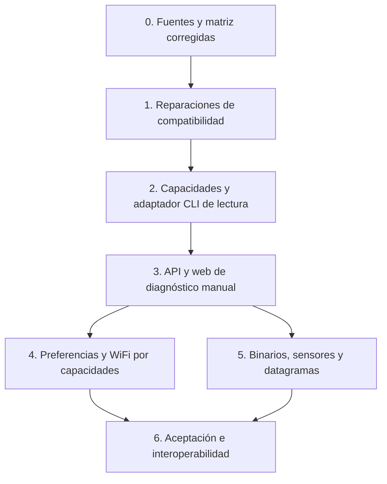

# Actualización por capas a MeshCore 1.18

Fecha inicial: 2026-10-15. Actualización: 2026-10-17. Capas1,2 y diagnóstico
manual de capa3 implementados con el alcance indicado abajo. Primera guarda de
capa4: bloquear repeat on en todos los ROOM, por decisión del usuario.
Investigación: [new1.18.md](../new1.18.md).
Evidencia de integración y QA: [ledger de la entrega](audits/2026-10-15-meshcore-1.18-integration.md).
Evolución: [capas2/3 y verificación](audits/2026-10-16-meshcore-1.18-layers-2-3.md).

## Objetivo y alcance verificable

Conservar las funciones actuales de la estación con companion 1.17.1/protocolo13
y admitir companion 1.18/protocolo14. Aprovechar desde la web las funciones
convenientes, según hardware, permisos y capacidad observada. La compatibilidad
del 100 % se considera un objetivo de la matriz acordada, no una afirmación
sobre todas las placas, forks, periféricos u opcodes experimentales.

No es necesario exponer todos los comandos para ser compatible con firmware1.18.
El bridge no debe reimplementar cambios internos de routing, CRC, ACK o PA del
firmware. Se conservan roles CLIENT/REPEATER/ROOM/SENSOR/LOCAL, claves y formato
de almacenamiento. No se añaden dependencias de producción a esta primera capa.

## Orden, dependencias y puertas de aceptación

Cada capa debe ser un conjunto revisable separado. Tras una capa fallida, se
conserva el estado anterior y se resuelve la causa antes de activar la siguiente.
La autorización de QA aislado del usuario en esta conversación no autoriza RF
real, cambio de firmware, instalación operativa ni nuevos valores de timers.

| Capa | Estado en esta entrega | Criterio para avanzar |
| --- | --- | --- |
| 0 Fuentes | Investigación corregida y ampliada | Diferenciar novedades de funciones previas; contratos con fuente por SHA. |
| 1 Compatibilidad mínima | Enum66, respuesta29, parser4dígitos y secretos WiFi; QA virtual en ledger2/3 | Evidencia global y cierre web documentados por separado; interoperabilidad física pendiente. |
| 2 Capacidades/adaptador | Implementada; aceptación virtual en ledger2/3 | Capacidad desconocida/ausente/presente; dos getters seguros; serialización y errores semánticos. |
| 3 API/web | Diagnóstico manual implementado; selector TCP pendiente | Contratos REST existentes ampliados, controles por capacidad y QA de navegador; sin nuevo WS. |
| 4 Configuración avanzada | Guarda ROOM implementada; controles avanzados pendientes | Administración remota de repetidores y ROOM priorizada por el usuario; nuevas emisiones requieren decisiones RF y lectura posterior fiable. |
| 5 Sensor/binario | Diseñada, pendiente | Asociación de identidad durable y decisiones de expiración/deltas/presupuesto. |
| 6 Aceptación | Pendiente | Matriz completa aprobada y verificación física autorizada por separado. |

## Capa 0 — fuentes y reversibilidad

Responsable: principal con investigador de protocolo. Fuentes: tags1.17.1/1.18,
SDK2.3.15/2.3.16, `CONTEXT.md` y consumidores actuales. `reference/` permanece
de sólo lectura; usar `git show`/`git diff` sin checkout ni pull.

Registrar versión de SDK instalada además de la fijada. No actualizar todos los
pins ni confundir el checkout SDK2.3.8 con la dependencia2.3.15. Preparar un
rollback por commit de cada capa; respaldar SQLite mediante el mecanismo de
backup de la aplicación antes de cualquier futura migración operativa. No copiar
aisladamente un archivo SQLite abierto en WAL ni borrar JSON históricos.

## Capa 1 — reparaciones sin funciones nuevas de emisión

Archivos: `src/protocol_types.py`, `src/serial/sdk_adapter.py`,
`src/repeater_manager.py`, `src/web/static/js/modules/repeater.js` y sus
artefactos generados. Regresiones nuevas `tests/test_meshcore_1_18_*.py`.

- Identificar comando66 y enrutar exclusivamente respuesta29 como éxito de
  transporte. ERR/DISABLED fallan; OK y respuestas ajenas no lo completan.
  Pushes siguen siendo asíncronos y un timeout no provoca reenvío.
- Leer la respuesta radio de cuatro dígitos y mantener formatos anteriores.
- Ocultar `wifi.pwd` y `wifi.password` en comandos, mappings y terminal/historial,
  incluidos prefijos de correlación. No habilitar lectura de contraseñas.

Aceptación: pruebas con SDK simulado y frames reales de contrato, sin conexión
física. Comprobar propiedad de respuestas, timeout, error, frecuencia sub-GHz/2.4
y secretos anidados. Los minificados deben corresponder a su fuente y manifest.
Rollback: revertir los hunks propios de esta capa, sin sobrescribir trabajo ajeno.

## Capa 2 — capacidades y CLI local de lectura

Implementación2026-10-16: `firmware_capabilities` y `run_firmware_cli` en el
adaptador, catálogo de configuración ampliado y ámbito administrativo separado.
Allowlist inicial exacta: `get radio`, `get freq`. El bloqueo tras respuesta
incierta se conserva hasta reconexión; no se generan prefijos ni reintentos.
Los puntos siguientes conservan los criterios de diseño y aceptación.

Archivos previstos: `src/serial/sdk_adapter.py`, protocolo del adaptador y
`src/admin/cli_command_executor.py`; mantener `src/admin_handler.py` como punto
de entrada del dominio actual. Los nombres son propiedad propuesta, no APIs ya
implementadas.

1. Derivar protocolo numérico de `DEVICE_INFO['fw ver']`, no de SELF_INFO ni
   del nombre de la placa. Verificar además método SDK. Mantener capacidad
   desconocida antes de recibir información y retirarla al desconectar/cambiar
   identidad para no heredar la de la radio anterior.
2. Reutilizar el catálogo de capacidades existente de configuración; no añadir
   varios mapas contradictorios. Añadir soporte de lectura firmware explícito
   con estado de disponibilidad y motivo.
3. Implementar un ámbito separado de CLI firmware, con allowlist de getters
   comprobados del dispatcher companion: `get radio`, `get freq` y getters de
   preferencias no secretas. Mantener comandos del bridge como `nodes`, `logs`
   y `config`. No reenviar automáticamente cualquier texto de su consola.
4. Usar el lock de respuesta existente. No adquirir dos veces el lock cuando el
   SDK ya esté envuelto. Nunca repetir por otra vía un comando que haya expirado.
5. Validar tipo, gramática, bytes y controles por comando. Conservar prefijos
   sólo si se generan/validan expresamente; no permitir que eludan la allowlist.
6. Distinguir transporte exitoso de respuesta `Error`, `ERR`, `Unknown command`,
   firmware sin soporte y timeout. Los setters requieren confirmación observada.

No se necesita subir a SDK2.3.16 para esto. Una actualización del SDK se valida
como capa independiente contra2.3.15 y2.3.16, con pins sincronizados en
`pyproject.toml`/`requirements.txt` y comprobadores que declaren versiones.
La inversión DTR de factory sólo se integra después de probar limpieza del
primer transporte, cancelación, espera de arranque y propiedad del reconnect.
No añadir otro bucle de reintentos sobre el backoff existente.

Aceptación: firmware13 sin emisión CLI;14 con getter válido; versión desconocida;
SDK sin método; desconexión concurrente; error semántico; bloqueo de setters y
secretos; intercalado de pushes. En navegador posterior sólo se habilita el botón
si la capacidad es positiva.

## Capa 3 — API, WebSocket y diagnóstico web manual

Implementación2026-10-16: snapshot bajo configuración existente y ámbito
`scope:"firmware"` en POST `/api/admin`; bloque manual ES/EN en Ajustes,
Telemetría y Estado. No se añadió endpoint ni evento WebSocket. El selector TCP
de la segunda parte de esta capa continúa pendiente. Aceptación y límites en
el ledger2/3 enlazado al inicio; no certificar implementación integral de capa3.

Archivos previstos: `src/web/controllers/config_controller.py`, catálogo/rutas y
OpenAPI ASGI, `src/web/static/js/modules/settings.js`, plantilla e i18n.
Reutilizar rutas y respuestas de configuración/admin cuando el contrato encaje.
Una nueva ruta, si fuera necesaria, debe documentar método, autorización,
parámetros, respuesta y códigos antes de implementarse.

Contrato propuesto: snapshot de capacidades dentro de la respuesta de
configuración ya existente; consulta manual administrativa para campos de
firmware. Estado desconocido debe renderizarse como no disponible, sin inventar
valores. Usar las políticas actuales de sesión/cookie, CSRF, API key y Origin;
no abrir un WebSocket o endpoint paralelo sin autenticación equivalente.
Errores400/422 para entrada,503 para dispositivo indisponible según convenciones
del controlador. No afirmar paridad OpenAPI por comparación de strings.

Pantalla local: bloque de compatibilidad que muestra protocolo/versión/SDK y
hardware observado; botón manual de diagnóstico no secreto. Separar valores
observados y cambios pendientes. Renderizar texto con textContent/escapeHtml y
mantener traducciones. No consultar al cambiar pestaña, al reconectar WS ni
mediante timer. Un evento existente de configuración/estado debe actualizar
capacidad; documentar campos y consumidores si se amplía.

Conexión: reutilizar `tcp://host:puerto` del driver. Explicar y validar puerto
explícito; distinguir el servidor TCP del bridge y el cliente hacia la radio.
La selección del transporte en web es trabajo pendiente, no una capacidad ya
presente sólo porque el backend lo admita. No mostrar credenciales en URI.

Aceptación: sesión/CSRF, lectura privada, firmware antiguo/desconectado,
preservación de formularios editados, errores y respuesta WS; desktop1920x1080
y móvil390x844 en estación virtual. Sin secretos en DOM, consola, eventos,
historial, logs, MQTT ni payloads genéricos.

## Capa 4 — configuración útil por hardware y rol

No crear un terminal arbitrario como atajo. Proponer controles estructurados de
CAD, ganancia RX, hash de ruta y otros parámetros realmente útiles. Cada control
declara capacidad, unidad, rango oficial, valor observado, efecto y necesidad de
reinicio. Un rango convertido a uint8 no equivale a un rango operativo seguro.

Archivos previstos: builders en `src/repeater_manager.py`, ejecutores
`src/admin/repeater_executor.py`, ejecutor local y controladores/SPA. Los controles
remotos comparten validación con comandos unitarios, preformateados y lotes.
La primera entrega bloquea `set repeat on` para todos los ROOM, también con
prefijo y en lotes completos antes de efectos secundarios. Es la política
explícita elegida por el usuario para versiones antiguas/desconocidas y1.18.
Conserva repeat off y repeat on para REPEATER; no consulta versiones por RF.
Evidencia y diseño restante: [administración remota](audits/2026-10-16-meshcore-1.18-remote-plan.md).
Nunca convertir esa guarda en permiso de chat a REPEATER o LOCAL.

`set radio` informa reinicio requerido. Conservar el valor anterior observado
hasta lectura posterior; no mostrar guardado como aplicado por recibir29. Una
futura configuración WiFi debe ser privada, sin lectura de password, sin guardar
secreto en historial y cubriendo DEBUG del SDK antes de enviar. Si aplicar WiFi
corta el enlace, conservar estado pendiente y recuperación manual documentada.

No migrar el presupuesto del bridge al dutycycle de firmware: son controles
distintos. No cambiar defaults operativos, frecuencia, potencia, af, multi-ACK o
delays sin completar el checklist con el usuario. Ningún guardado debe iniciar
adverts ni rearmar cooldowns.

## Capa 5 — recepción binaria y sensores; datagramas opcionales

Archivos previstos: `src/rx_router.py`, handlers/decoder de sensores,
`src/station_database.py` o repositorio real de persistencia correspondiente,
contratos REST/WS y módulos web de telemetría. Confirmar nombres exactos antes de
asignar propiedad; no añadir migración hasta tener modelo de dominio aprobado.

Primero conservar `BINARY_RESPONSE` opaco sin identidad inventada, con origen
desconocido y sin eco de MQTT a TX. Después modelar suscripción durable: tag,
pubkey, tipo, timestamp/expiración, deltas y estado. Evitar colisiones de tag,
rechazar muestras fuera de asociación, separar timestamp de LPP y no renovar
suscripciones automáticamente tras guardar o reiniciar.

La UI de sensores puede mostrar observaciones y última muestra; la creación de
suscripciones queda deshabilitada hasta que el usuario elija umbrales, expiración,
renovación y presupuesto. No agregar polling para suplir asociaciones ausentes.

Datagramas de canal sólo si existe un caso de uso concreto en web. SDK2.3.16
necesita guardas propias de ruta (modo, divisibilidad, hops, bytes totales) antes
de delegar. Mantener163bytes SDK hasta verificar otra estrategia. Introducirlos
en la cola/airtime existente, sin interfaz de inyección raw libre. CLI remota
companion tipo3 y permiso0x10 queda fuera de la activación inicial.

## Checklist obligatorio de impacto en malla

| Cambio | Airtime | Spam/bucles | Guardado/reinicio y timers |
| --- | --- | --- | --- |
| Investigación, parser, redacción | Cero paquetes añadidos | Ningún publicador nuevo | No cambian estado ni timers. |
| Respuesta raw66->29 | El proxy ya transmitía; sólo cambia su respuesta | Sin reintento añadido | No crea timer periódico ni cambia cooldown. |
| Getters Companion locales permitidos | Cero RF sólo para getters comprobados | Manual; sin encadenar publicaciones TX | Sin polling ni renovación al guardar. |
| Setters locales/remotos | Depende de comando; remotos pueden implicar login/comando/respuesta y hops | Cola, deduplicación y origen propio existentes; no fallback doble | Preservar últimos disparos y cooldown SQLite. |
| Suscripciones sensor | Solicitud/renovación y pushes por suscriptor/deltas | Evitar suscripciones duplicadas y feedback MQTT | Persistir asociación y expiración antes de activar; no renovar implícitamente. |
| Datagramas, raw o retries | Depende de tamaño/ruta/nodos; no aprobado un nuevo presupuesto | Deben pasar admisión TX y límites definidos | No timers de reenvío en RAM ni replay al arrancar. |

Decisiones pendientes que se solicitarán antes de esas implementaciones: lista
de controles RF que se desean y, para sensores, expiración/renovación/deltas y
presupuesto de suscripciones. Las políticas ROOM y de pausa manual ya están
resueltas: el usuario eligió bloquear repeat on en todos los ROOM y cero pausa
mínima entre órdenes manuales de infraestructura. La segunda decisión se integra
en una entrega posterior separada, conservando los controles de automatizaciones.
No se ha elegido ningún umbral o intervalo nuevo unilateralmente.

## Capa 6 — matriz de aceptación y despliegue

| Dimensión | Casos mínimos |
| --- | --- |
| Firmware/SDK |1.17.1/protocolo13 y1.18/protocolo14; SDK2.3.15 y candidato2.3.16; versión ausente. |
| Transporte | Serial simulado y TCP loopback; arranque, DTR/cancelación, desconexión, timeout tardío, exclusión entre comandos. |
| Dominio | CLIENT, REPEATER, ROOM, SENSOR y LOCAL; contactos/chat y administración separados. |
| RF/estado | Cola TX, ACK, deduplicación, timestamps SQLite, guardar/reiniciar sin ráfaga. |
| API/SPA | Autenticación/CSRF, REST/WS/OpenAPI, datos observados, errores, viewport, formularios pendientes. |
| Seguridad | Contraseñas y claves ausentes de logs, SDK DEBUG, historial, DOM, eventos y MQTT. |
| Binarios | Truncados/desconocidos, tag sin contexto, ruta multibyte y emisor no demostrado. |

Ejecutar pytest con cobertura, mypy estricto, Ruff y navegador; reportar versión
real, skips y conflictos de dependencias. Los checks no certifican alcance RF ni
interoperabilidad con cada placa. Antes de desplegar una capa, revisar diff,
backup y procedimiento de reversión; no actualizar firmware de la radio desde
esta tarea. El ensayo final con hardware dedicado requiere autorización separada
y no utiliza una estación operativa como fixture.
