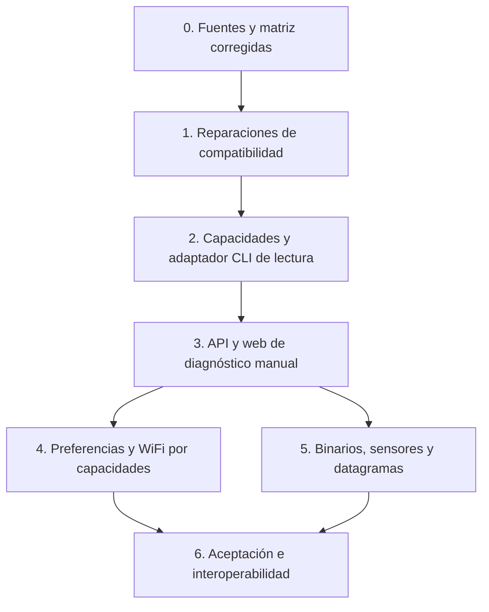

# Actualización por capas a MeshCore 1.18

Fecha inicial: 2026-10-15. Actualización: 2026-10-17. Capas 1, 2, 3, 4 y 5
implementadas en su totalidad conforme a las decisiones del usuario; Capa 6
consolidada a nivel documental y de verificación estática (ejecución de suites
de pruebas y ensayo físico pendientes de orden explícita).
Investigación e integración: [ledger de la entrega](../audits/2026-10-15-meshcore-1.18-integration.md).
Evolución: [capas 2/3 y verificación](../audits/2026-10-16-meshcore-1.18-layers-2-3.md),
[selector de transporte](../audits/2026-10-17-companion-connection.md),
[preferencias locales](../audits/2026-10-17-firmware-preferences.md),
[preferencias remotas](../audits/2026-10-17-remote-firmware-preferences.md),
[WiFi Companion](../audits/2026-10-17-firmware-wifi.md) y
[suscripciones de sensores](../audits/2026-10-17-sensor-subscriptions.md).

## Nota de vigencia — 2026-10-23

La matriz y las afirmaciones de QA siguientes registran las entregas del 15–17 de octubre; no son una autorización vigente para ejecutar suites. La revisión documental actual confirma por lectura las capacidades en código y preserva su evidencia histórica. La implementación actual y sus límites se consultan en [PROTOCOL_SPEC.md](../PROTOCOL_SPEC.md) y [ARCHITECTURE.md](../ARCHITECTURE.md); no se realizó interoperabilidad física durante esta revisión.

## Objetivo y alcance verificable

Conservar las funciones actuales de la estación con companion 1.17.1/protocolo13
y admitir companion 1.18/protocolo14. Aprovechar desde la web las funciones
convenientes, según hardware, permisos y capacidad observada. La compatibilidad
del 100 % se considera un objetivo de la matriz acordada, no una afirmación
sobre todas las placas, forks, periféricos u opcodes experimentales.

No es necesario exponer todos los comandos para ser compatible con firmware1.18.
El bridge no debe reimplementar cambios internos de routing, CRC, ACK o PA del
firmware. Se conservan roles CLIENT/REPEATER/ROOM/SENSOR/LOCAL, claves y formato
de almacenamiento. No se añaden dependencias de producción a esta primera capa.

## Orden, dependencias y puertas de aceptación

Cada capa debe ser un conjunto revisable separado. Tras una capa fallida, se
conserva el estado anterior y se resuelve la causa antes de activar la siguiente.
La autorización de QA aislado del usuario en esta conversación no autoriza RF
real, cambio de firmware, instalación operativa ni nuevos valores de timers.

| Capa | Estado en esta entrega | Criterio para avanzar |
| --- | --- | --- |
| 0 Fuentes | Investigación corregida y ampliada | Diferenciar novedades de funciones previas; contratos con fuente por SHA. |
| 1 Compatibilidad mínima | Enum66, respuesta29, parser4dígitos y secretos WiFi; QA virtual en ledger2/3 | Evidencia global y cierre web documentados por separado; interoperabilidad física pendiente. |
| 2 Capacidades/adaptador | Implementada (9 getters seguros + escrituras estructuradas); aceptación virtual en ledger2/3 | Capacidad desconocida/ausente/presente; getters seguros; serialización y errores semánticos. |
| 3 API/web | Diagnóstico manual y selector Serial/TCP implementados; regresiones escritas | Contratos REST existentes ampliados, controles por capacidad y sin nuevo WS. |
| 4 Configuración avanzada | Guarda ROOM, pausa manual0, CAD local/remoto on/off, RX gain sólo lectura y WiFi Companion local implementados; regresiones escritas | RX gain sólo lectura; WiFi local con password write-only e invalidación por sesión. |
| 5 Sensor/binario | Implementada (`BINARY_RESPONSE 0x8C` seguro + suscripciones manuales `0x08`/`0x09` 1h con deltas equilibrados); regresiones escritas | Asociación de identidad durable en SQLite, sin auto-renovación y `push_tag` oculto en vistas públicas. |
| 6 Aceptación | Documentación reconciliada y verificación estática completada (`mypy`, `ruff`, bundle, i18n, docs) | Ejecución de suites (`pytest`/Playwright) y verificación física sujetas a orden explícita del usuario. |

## Capa 0 — fuentes y reversibilidad

Responsable: principal con investigador de protocolo. Fuentes: tags1.17.1/1.18,
SDK2.3.15/2.3.16, `CONTEXT.md` y consumidores actuales. `reference/` permanece
de sólo lectura; usar `git show`/`git diff` sin checkout ni pull.

Registrar versión de SDK instalada además de la fijada. No actualizar todos los
pins ni confundir el checkout SDK2.3.8 con la dependencia2.3.15. Preparar un
rollback por commit de cada capa; respaldar SQLite mediante el mecanismo de
backup de la aplicación antes de cualquier futura migración operativa. No copiar
aisladamente un archivo SQLite abierto en WAL ni borrar JSON históricos.

## Capa 1 — reparaciones sin funciones nuevas de emisión

Archivos: `src/protocol_types.py`, `src/serial/sdk_adapter.py`,
`src/repeater_manager.py`, `src/web/static/js/modules/repeater.js` y sus
artefactos generados. Regresiones nuevas `tests/test_meshcore_1_18_*.py`.

- Identificar comando66 y enrutar exclusivamente respuesta29 como éxito de
  transporte. ERR/DISABLED fallan; OK y respuestas ajenas no lo completan.
  Pushes siguen siendo asíncronos y un timeout no provoca reenvío.
- Leer la respuesta radio de cuatro dígitos y mantener formatos anteriores.
- Ocultar `wifi.pwd` y `wifi.password` en comandos, mappings y terminal/historial,
  incluidos prefijos de correlación. No habilitar lectura de contraseñas.

Aceptación: pruebas con SDK simulado y frames reales de contrato, sin conexión
física. Comprobar propiedad de respuestas, timeout, error, frecuencia sub-GHz/2.4
y secretos anidados. Los minificados deben corresponder a su fuente y manifest.
Rollback: revertir los hunks propios de esta capa, sin sobrescribir trabajo ajeno.

## Capa 2 — capacidades y CLI local de lectura

Implementación2026-10-16: `firmware_capabilities` y `run_firmware_cli` en el
adaptador, catálogo de configuración ampliado y ámbito administrativo separado.
Allowlist inicial exacta: `get radio`, `get freq`. El bloqueo tras respuesta
incierta se conserva hasta reconexión; no se generan prefijos ni reintentos.
Los puntos siguientes conservan los criterios de diseño y aceptación.

Extensión2026-10-17: la lista exacta incorpora `get cad`, `get radio.rxgain` y
`get path.hash.mode`. Continúan siendo consultas locales manuales de preferencias,
sin demostrar soporte físico. La acción estructurada de escritura CAD se describe
en capa4 y no se admite en el ámbito de getters.

Archivos previstos: `src/serial/sdk_adapter.py`, protocolo del adaptador y
`src/admin/cli_command_executor.py`; mantener `src/admin_handler.py` como punto
de entrada del dominio actual. Los nombres son propiedad propuesta, no APIs ya
implementadas.

1. Derivar protocolo numérico de `DEVICE_INFO['fw ver']`, no de SELF_INFO ni
   del nombre de la placa. Verificar además método SDK. Mantener capacidad
   desconocida antes de recibir información y retirarla al desconectar/cambiar
   identidad para no heredar la de la radio anterior.
2. Reutilizar el catálogo de capacidades existente de configuración; no añadir
   varios mapas contradictorios. Añadir soporte de lectura firmware explícito
   con estado de disponibilidad y motivo.
3. Implementar un ámbito separado de CLI firmware, con allowlist de getters
   comprobados del dispatcher companion: `get radio`, `get freq` y getters de
   preferencias no secretas. Mantener comandos del bridge como `nodes`, `logs`
   y `config`. No reenviar automáticamente cualquier texto de su consola.
4. Usar el lock de respuesta existente. No adquirir dos veces el lock cuando el
   SDK ya esté envuelto. Nunca repetir por otra vía un comando que haya expirado.
5. Validar tipo, gramática, bytes y controles por comando. Conservar prefijos
   sólo si se generan/validan expresamente; no permitir que eludan la allowlist.
6. Distinguir transporte exitoso de respuesta `Error`, `ERR`, `Unknown command`,
   firmware sin soporte y timeout. Los setters requieren confirmación observada.

No se necesita subir a SDK2.3.16 para esto. Una actualización del SDK se valida
como capa independiente contra2.3.15 y2.3.16, con pins sincronizados en
`pyproject.toml`/`requirements.txt` y comprobadores que declaren versiones.
La inversión DTR de factory sólo se integra después de probar limpieza del
primer transporte, cancelación, espera de arranque y propiedad del reconnect.
No añadir otro bucle de reintentos sobre el backoff existente.

Aceptación: firmware13 sin emisión CLI;14 con getter válido; versión desconocida;
SDK sin método; desconexión concurrente; error semántico; bloqueo de setters y
secretos; intercalado de pushes. En navegador posterior sólo se habilita el botón
si la capacidad es positiva.

## Capa 3 — API, WebSocket y diagnóstico web manual

Implementación2026-10-16: snapshot bajo configuración existente y ámbito
`scope:"firmware"` en POST `/api/admin`; bloque manual ES/EN en Ajustes,
Telemetría y Estado. No se añadió endpoint ni evento WebSocket. El selector TCP
se añadió el2026-10-17 como preferencia de próximo arranque, sin reconexión al
guardar. Aceptación del diagnóstico en el ledger2/3 enlazado al inicio; el
selector conserva su propia aceptación pendiente de pruebas autorizadas.

Archivos previstos: `src/web/controllers/config_controller.py`, catálogo/rutas y
OpenAPI ASGI, `src/web/static/js/modules/settings.js`, plantilla e i18n.
Reutilizar rutas y respuestas de configuración/admin cuando el contrato encaje.
Una nueva ruta, si fuera necesaria, debe documentar método, autorización,
parámetros, respuesta y códigos antes de implementarse.

Contrato propuesto: snapshot de capacidades dentro de la respuesta de
configuración ya existente; consulta manual administrativa para campos de
firmware. Estado desconocido debe renderizarse como no disponible, sin inventar
valores. Usar las políticas actuales de sesión/cookie, CSRF, API key y Origin;
no abrir un WebSocket o endpoint paralelo sin autenticación equivalente.
Errores400/422 para entrada,503 para dispositivo indisponible según convenciones
del controlador. No afirmar paridad OpenAPI por comparación de strings.

Pantalla local: bloque de compatibilidad que muestra protocolo/versión/SDK y
hardware observado; botón manual de diagnóstico no secreto. Separar valores
observados y cambios pendientes. Renderizar texto con textContent/escapeHtml y
mantener traducciones. No consultar al cambiar pestaña, al reconectar WS ni
mediante timer. Un evento existente de configuración/estado debe actualizar
capacidad; documentar campos y consumidores si se amplía.

Conexión: reutilizar `tcp://host:puerto` del driver. Explicar y validar puerto
explícito; distinguir el servidor TCP del bridge y el cliente hacia la radio.
La web permite heredar `SERIAL_PORT`, elegir USB/Serial o indicar host DNS/IPv4
y puerto TCP explícito. `companion_port` se guarda en el documento SQLite de
servicios mediante GET/POST `/api/services/config`; vacío hereda el entorno.
La respuesta distingue destino de próximo arranque y puerto activo; el operador
reinicia manualmente el proceso para aplicarlo. No se cambian transportes al
guardar ni se consulta conectividad. IPv6 queda pendiente porque el adaptador
actual divide la autoridad TCP por el primer `:`. No se admiten credenciales en
URI. Contrato y evidencia: [selector de conexión](../audits/2026-10-17-companion-connection.md).

Aceptación: sesión/CSRF, lectura privada, firmware antiguo/desconectado,
preservación de formularios editados, errores y respuesta WS; desktop1920x1080
y móvil390x844 en estación virtual. Sin secretos en DOM, consola, eventos,
historial, logs, MQTT ni payloads genéricos.

## Capa 4 — configuración útil por hardware y rol

No crear un terminal arbitrario como atajo. Proponer controles estructurados de
CAD, ganancia RX, hash de ruta y otros parámetros realmente útiles. Cada control
declara capacidad, unidad, rango oficial, valor observado, efecto y necesidad de
reinicio. Un rango convertido a uint8 no equivale a un rango operativo seguro.

Decisión2026-10-17: el usuario eligió **CAD on/off; RX gain sólo lectura**.
Se añade una acción local estructurada `set_preference`, con preferencia exacta
`cad` y booleano estricto. La SPA exige consultar CAD manualmente antes de
guardar y volver a consultarlo tras cada intento; no encadena lecturas. El acuse
significa preferencia aceptada (`hardware_verified:false`), sin acreditar soporte
del driver ni aplicación física. El firmware aplica CAD en un ciclo ya existente,
sin timer ni reinicio añadido por el bridge. Hash conserva su editor binario0/1/2.
Se descarta el setter RX en esta entrega porque el firmware puede persistir el
valor incluso respondiendo `Error: unsupported`. El snapshot informa permiso de
escritura de preferencia, nunca capacidad CAD física. Evidencia y aceptación
pendiente: [preferencias locales](../audits/2026-10-17-firmware-preferences.md).

Extensión remota2026-10-17: acciones unitarias `get_cad`, `get_rx_gain` y
`set_cad` para infraestructura REPEATER/ROOM inequívoca, con validación anterior
a alta/login/cooldown y destino congelado. Se reutiliza la política manual HTTP0
ya acordada; no se amplían lotes ni se crean lecturas, topics o reintentos
automáticos. Respuestas `preferences`/`saved_preferences` separadas de telemetría
y `applied`, siempre `hardware_verified:false`. La web exige lectura CAD previa
y posterior manual, descarta respuestas de otro modal/destino y no guarda las
preferencias en el registro como estado RF activo. [Plan y entrega remota](../audits/2026-10-17-remote-firmware-preferences.md).

Archivos previstos: builders en `src/repeater_manager.py`, ejecutores
`src/admin/repeater_executor.py`, ejecutor local y controladores/SPA. Los controles
remotos comparten validación con comandos unitarios, preformateados y lotes.
La primera entrega bloquea `set repeat on` para todos los ROOM, también con
prefijo y en lotes completos antes de efectos secundarios. Es la política
explícita elegida por el usuario para versiones antiguas/desconocidas y1.18.
Conserva repeat off y repeat on para REPEATER; no consulta versiones por RF.
Evidencia y diseño restante: [administración remota](../audits/2026-10-16-meshcore-1.18-remote-plan.md).

Desde2026-10-17, la administración HTTP de infraestructura inequívoca usa cero
pausa mínima entre órdenes, según decisión explícita del usuario. El keyword
manual se origina en el controlador autenticado; JSON no concede la excepción.
Los flujos MQTT/internos conservan su default y los timestamps siguen guardándose.
Se conservan gateway SDK, locks y delays de protocolo; no atribuir a todos los
comandos admin la cola TxRateLimiter de chat. Otro cliente autenticado de esas
rutas HTTP comparte la política. [Implementación y gate](../audits/2026-10-17-meshcore-1.18-manual-admin.md).
Nunca convertir esa guarda en permiso de chat a REPEATER o LOCAL.

`set radio` informa reinicio requerido. Conservar el valor anterior observado
hasta lectura posterior; no mostrar guardado como aplicado por recibir29. La
configuración WiFi Companion local (`action:"set_wifi", scope:"firmware"`) es
privada, con getters seguros (`get wifi.ssid`, `get wifi.enabled`,
`get wifi.status`, `get wifi.ip`), sin lectura de password (`get wifi.pwd`
bloqueado), limpiando el campo en DOM al enviar y redactando trazas DEBUG del
SDK (`_MeshcoreLogRedactionFilter` y `SystemLogHandler`). Informa
`reboot_required:true` y `hardware_verified:false`. [Evidencia WiFi](../audits/2026-10-17-firmware-wifi.md).

No migrar el presupuesto del bridge al dutycycle de firmware: son controles
distintos. No cambiar defaults operativos, frecuencia, potencia, af, multi-ACK o
delays sin completar el checklist con el usuario. Ningún guardado debe iniciar
adverts ni rearmar cooldowns.

## Capa 5 — recepción binaria y sensores; datagramas opcionales

Implementación 2026-10-17: normalización pasiva segura de `BINARY_RESPONSE (0x8C)`
y suscripciones manuales de sensores (`0x08` subscribe / `0x09` unsubscribe) con
el preset equilibrado elegido por el usuario (`timeout = 3600 s`, deltas mínimos
de temperatura $0.5\,^\circ\text{C}$ = `01670005` y voltaje $0.10\,\text{V}$ = `0174000a`),
100 % manuales y sin renovación automática.

Archivos implementados: `src/protocol_types.py`, `src/station_database.py` (tabla
`sensor_subscriptions`), `src/rx_router.py`, `src/routers/system_handler.py`,
`src/admin_handler.py`, `src/admin/repeater_executor.py`, `src/contact_manager.py`,
`src/web/controllers/nodes_controller.py`, `src/web/static/js/modules/nodes.js` y
`src/web/static/js/i18n.js`. Regresiones escritas en `tests/test_sensor_subscriptions.py`
y `tests/test_sensor_subscriptions_static_contract.py` (contrato estático, sin navegador). Evidencia y contratos:
[suscripciones de sensores](../audits/2026-10-17-sensor-subscriptions.md).

`RxEventRouter._extract_normalized_meta` conserva `BINARY_RESPONSE` opaco sin
identidad inventada (`sender=None`, `sender_known=False`). `SystemHandler`
correlaciona únicamente los `push_tag` con suscripción activa y no expirada en
SQLite (`resolve_sensor_subscription_by_tag`), separa `sample_timestamp (uint32 LE)`
del sufijo CayenneLPP, actualiza la telemetría del nodo `SENSOR` y publica en
`meshcore/rx/telemetry` sin eco a TX. Al vencer `expires_at`, la fila pasa a
`expired` de forma perezosa sin iniciar renovaciones automáticas. El token
`push_tag` nunca se expone en las vistas públicas (`get_sensor_subscription_public_view`).

La tarjeta de cada nodo `SENSOR` (`adv_type == 4`) en `#nodesUnifiedGridUi`
muestra el badge de suscripción (`Activa`/`Expirada`) y los botones manuales
`Suscribir 1h` y `Cancelar suscripción` (POST `/api/admin` con
`subscribe_sensor` y `unsubscribe_sensor`).

Datagramas de canal (`SEND_CHANNEL_DATA = 62`) quedan fuera de la activación por
defecto hasta que exista un caso de uso concreto en web, manteniendo las guardas
de ruta y tamaño documentadas. CLI remota companion tipo 3 y permiso `0x10`
permanece desactivada.

## Checklist obligatorio de impacto en malla

| Cambio | Airtime | Spam/bucles | Guardado/reinicio y timers |
| --- | --- | --- | --- |
| Investigación, parser, redacción | Cero paquetes añadidos | Ningún publicador nuevo | No cambian estado ni timers. |
| Respuesta raw66->29 | El proxy ya transmitía; sólo cambia su respuesta | Sin reintento añadido | No crea timer periódico ni cambia cooldown. |
| Getters Companion locales permitidos | Cero RF sólo para getters comprobados | Manual; sin encadenar publicaciones TX | Sin polling ni renovación al guardar. |
| Preferencia CAD local y WiFi Companion | Cero paquetes RF en lectura/escritura local; CAD afecta acceso al canal en TX futuras | Una orden manual tras lectura previa; sin reintento, MQTT ni readback automático | Persiste el firmware; no se añaden timers ni se alteran cooldowns/airtime del bridge. |
| Setters locales/remotos | Depende de comando; remotos pueden implicar login/comando/respuesta y hops | Gateway/locks SDK; cola TX donde exista, sin fallback doble ni temporizador nuevo | Preservar últimos disparos y cooldown SQLite; pausa manual0 elegida por usuario. |
| Suscripciones sensor (`0x08`/`0x09` + `0x8C`) | 1 paquete puntual por orden manual (`3600 s`) + pushes condicionados a deltas ($0.5\,^\circ\text{C}$, $0.10\,\text{V}$) | Sin feedback MQTT a TX; correlación por `push_tag` activo en SQLite | Persistido en tabla `sensor_subscriptions`; 100 % manual sin timers de auto-renovación. |
| Datagramas, raw o retries | No activados en esta entrega | N/A | Sin timers de reenvío en RAM ni replay al arrancar. |

Todas las decisiones de usuario para las Capas 1–5 han quedado resueltas e
implementadas: bloqueo de `set repeat on` en todos los `ROOM`, cero pausa mínima
entre órdenes HTTP manuales de infraestructura, `CAD` manual (`on`/`off`) con
`RX gain` de sólo lectura, configuración WiFi Companion local write-only y
suscripciones manuales de sensores de 1 hora con deltas equilibrados sin
renovación automática. No se ha elegido ningún umbral o intervalo de forma
unilateral.

## Capa 6 — matriz de aceptación y despliegue

| Dimensión | Casos mínimos |
| --- | --- |
| Firmware/SDK |1.17.1/protocolo13 y1.18/protocolo14; SDK2.3.15 y candidato2.3.16; versión ausente. |
| Transporte | Serial simulado y TCP loopback; arranque, DTR/cancelación, desconexión, timeout tardío, exclusión entre comandos. |
| Dominio | CLIENT, REPEATER, ROOM, SENSOR y LOCAL; contactos/chat y administración separados. |
| RF/estado | Cola TX, ACK, deduplicación, timestamps SQLite, guardar/reiniciar sin ráfaga. |
| API/SPA | Autenticación/CSRF, REST/WS/OpenAPI, datos observados, errores, viewport, formularios pendientes. |
| Seguridad | Contraseñas y claves ausentes de logs, SDK DEBUG, historial, DOM, eventos y MQTT. |
| Binarios | Truncados/desconocidos, tag sin contexto, ruta multibyte y emisor no demostrado. |

Ejecutar pytest con cobertura, mypy estricto, Ruff y navegador; reportar versión
real, skips y conflictos de dependencias. Los checks no certifican alcance RF ni
interoperabilidad con cada placa. Antes de desplegar una capa, revisar diff,
backup y procedimiento de reversión; no actualizar firmware de la radio desde
esta tarea. El ensayo final con hardware dedicado requiere autorización separada
y no utiliza una estación operativa como fixture.
