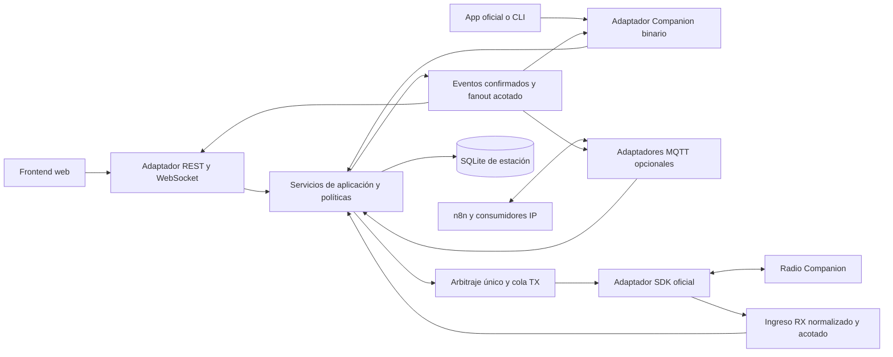

# Plan de evolución de MeshCore Bridge

**Fecha:** 2026-10-21.

**Base examinada:** `5a0c0614c922773699e7ee982b5d1b84ee05ee7f`, rama `main`.

**Estado original (2026-10-21):** investigación y propuesta de implementación.

**Conciliación del 2026-10-23:** este documento conserva el diagnóstico de su base original; ya no describe por sí solo el estado del checkout. Los commits posteriores implementaron contratos F0/F1, aislamiento F2, servicios de aplicación F3, registro de capacidades F4, precompilación de expresiones F5 y documentación F7. Véanse [los contratos de evolución](docs/evolution/F0_CONTRACTS_AND_PROFILES.md), [ADRs 0020–0024](docs/README.md) y la [revisión actual](docs/audits/2026-10-23-documentation-scripts-review.md). La separación física de despliegues y las mediciones de rendimiento siguen requiriendo evidencia propia; las dependencias base de `pyproject.toml` todavía incluyen web y MQTT. Los hallazgos y números de línea siguientes son históricos, no una lista de fallos actuales.

**Autoría:** revisión coordinada entre especialistas de arquitectura y diseño, integraciones y despliegue, resiliencia y calidad, con integración y contraste del agente principal.

## 1. Objetivo, alcance y conclusión

Evolucionar la aplicación hacia un monolito modular, mantenible y medible, con radio, cola TX y estado de estación bajo una autoridad única. Web, servidor TCP Companion, MQTT local y MQTT comunitario serán adaptadores opcionales que utilicen servicios de aplicación con contratos explícitos. El frontend podrá distribuirse por separado; separar el backend web en otro proceso será una decisión posterior basada en necesidades y mediciones.

El objetivo de escalabilidad es soportar más eventos y consumidores IP sin que estos degraden la recepción y la persistencia. No significa aumentar las transmisiones RF: el medio LoRa conserva sus restricciones de airtime, prioridad y capacidad física.

Este documento cubre los ocho objetivos solicitados:

| Objetivo | Entrega propuesta |
| --- | --- |
| 1. Corregir exposición, repetición y prefijos MQTT | Fase F1: instalación segura, metadata de ingreso, idempotencia y resolución única de tópicos. |
| 2. Aislar recepción y persistencia | Fase F2: admisión acotada, persistencia independiente y salidas por consumidor. |
| 3. Extraer canales y operaciones de estación | Fase F3: servicios de aplicación compartidos y compatibilidad de adaptadores. |
| 4. Completar opcionalidad | Fase F4: paquetes, configuración, construcción, arranque, salud y UI coherentes. |
| 5. Separar despliegues con justificación | Fase F6: frontend independiente y evaluación condicionada de separación del backend. |
| 6. Mejorar ingeniería y calidad | Contratos, disciplina de tipos, regresiones, CI, observabilidad y documentación en F0–F7. |
| 7. Mejorar estructura y mantenibilidad | Dependencias dirigidas hacia aplicación/dominio, migración gradual y propiedad de módulos. |
| 8. Optimizar | Fase F5: línea base reproducible y mejoras justificadas por perfiles reales. |

### Alcance de la investigación

Se inspeccionaron fuentes, configuración de ejemplo, dependencias, instaladores, CI y documentación. No se ejecutaron suites, fuzzing, navegador, benchmarks, instaladores ni servicios; no se utilizaron datos operativos o secretos ni se transmitió por radio. Los riesgos de sobrecarga son deducciones del flujo de código, no fallos medidos. La exposición de una instalación real depende de sus interfaces y firewall, que no se inspeccionaron.

Se conserva la ubicación `nuevo.md` en la raíz por petición expresa del usuario. La documentación canónica seguirá en `docs/`; este plan no sustituye a `CONTEXT.md`, las especificaciones ni los ADR aceptados.

## 2. Diagnóstico sustentado en el código

Las referencias indican líneas del checkout examinado y pueden desplazarse al implementar. La evidencia primaria es el código, con los documentos como contexto.

| ID | Hecho observado y fuente | Consecuencia | Prioridad |
| --- | --- | --- | --- |
| H1 | `install.sh:331–355` instala Mosquitto y escribe `listener 1883 0.0.0.0` / `allow_anonymous true`. `mqtt_client.py:248–254` suscribe TX/admin; `mqtt_dispatcher.py:168–183` los ejecuta. | Con broker accesible y cliente habilitado, un publicador de red puede ordenar acciones sin login web. No se afirma exposición actual. | Alta, seguridad de despliegue. |
| H2 | `src/mqtt_client.py:278–300` pierde metadata `retain`/`dup`; `src/mqtt_dispatcher.py:216–242` usa `request_id` como correlación; `src/rate_limiter.py:714–765` admite cada llamada. | Una orden retenida puede ejecutarse otra vez al resuscribir; falta garantía de idempotencia de aplicación. | Alta, seguridad operacional. |
| H3 | `src/mqtt_client.py:78–93` deriva tópicos del prefijo dinámico, pero `src/rx_router.py:1098–1123` y `src/bridge_core.py:1121` publican RX/ACK con constantes globales. | Un cambio desde la UI puede separar órdenes, eventos y confirmaciones entre prefijos distintos. | Media, contrato funcional. |
| H4 | `src/bridge_core.py:301–357` programa logs y TCP en `rx_router._enqueue_work`; `src/rx_router.py:431–456` rechaza al saturar la cola. | Trabajo observacional y recepción compiten por admisión; puede rechazarse trabajo de chat antes de persistir. | Alta bajo sobrecarga. |
| H5 | `src/bridge_core.py:179–208` persiste y luego espera WebSocket; `src/web/asgi_ws_hub.py:254–287` espera entregas a consumidores con timeout. | Los consumidores lentos todavía pueden ocupar trabajadores relacionados con RX. Hay mitigaciones, pero no aislamiento completo. | Alta bajo sobrecarga. |
| H6 | `src/mqtt_client.py:294–296` y `src/external_mqtt_client.py:579–581` programan callbacks antes del límite de `src/mqtt_dispatcher.py:80–87`. | Puede crecer el trabajo pendiente entre hilos antes de que actúe el límite de tareas. | Media, recursos. |
| H7 | `src/web/controllers/channels_controller.py:27–50` posee canales, locks y persistencia; `src/bridge_core.py:888–900` y `src/routers/system_handler.py:164–169` acceden a estado web. | Parte del estado de estación depende de la existencia de la presentación web. | Media, arquitectura. |
| H8 | `src/services_manager.py:64–65,137–154` construye el cliente local aun desactivado; `src/mqtt_client.py:112–119` carga TLS al construir. | Una integración apagada conserva dependencias y puede fallar antes del arranque por sus certificados. | Media, opcionalidad. |
| H9 | `pyproject.toml:11–33`, `requirements.txt` y `scripts/check_runtime_dependencies.py:13–39` exigen MQTT y/o web en perfiles que aparentan ser mínimos. | Desactivar en configuración no produce una instalación mínima real. | Media, distribución. |
| H10 | `src/bridge_core.py:705–755` engloba el arranque web en el rollback global. `:788–817` drena RX y escrituras sin un deadline global explícito. | Un adaptador puede impedir el arranque; los límites parciales de cierre no equivalen a un límite global. | Media, disponibilidad. |
| H11 | `src/services_manager.py:409–438` reescribe referencias privadas `_ctx`; `src/web/controllers/base.py:44–52` recibe `bridge: Any`. | Las fronteras permiten acceso excesivo a implementación y estado mutable. | Media, mantenibilidad. |
| H12 | `src/web/static/js/app.js:35–69` comparte referencias a módulos; `core/auth.js:102–113` intercepta `window.fetch`; `core/websocket.js:19–22` usa el host actual. | Separar despliegues necesita diseñar transporte y autenticación; el frontend también requiere contratos internos más pequeños. | Media, evolución. |

### Capacidades que deben conservarse

- Web y TCP Companion ya se comunican directamente con el bridge: MQTT no es su bus intermedio (`tx_controller.py:73–90`, `bridge_core.py:358–386`).
- `BaseSerialAdapter`, SDK oficial y adaptador virtual ofrecen una frontera de hardware aprovechable.
- SQLite ya es autoritativo; chat, ACK, airtime y cooldowns no deben volver a JSON como autoridad.
- Existen sesiones HTTP/WS, CSRF, protección de secretos, colas limitadas, control de airtime y recarga de servicios con rollback.
- La SPA ya utiliza módulos ES, EventBus, caché por estación y activos comprimidos previamente. Estas capacidades no necesitan una reescritura en otro framework.
- El proxy TCP ya diferencia respuestas dirigidas y eventos, posee transacciones y limita clientes lentos. Su framing binario no debe sustituirse por JSON.

### Discrepancias documentales que se deben conciliar

El [ADR 0006](docs/adr/0006-tcp-companion-server-proxy.md) conserva descripciones históricas de difusión de todas las respuestas, bypass del limitador y máximo de 512 bytes. El código actual usa propietario de respuesta, clasificación RF/control y máximo de 300 bytes (`tcp_companion_server.py:30,146–156,428–443`; `bridge_core.py:359–386`). Registrar la evolución y un ADR de sustitución/enmienda; conservar el texto histórico identificado como tal.

La [guía de pruebas](docs/TESTING.md) contiene una afirmación histórica de que `db_path` se ignora, mientras el constructor actual lo utiliza (`bridge_core.py:80–106`). Revisar ese texto cuando se actualice la guía. Este hallazgo no implica que toda la documentación esté obsoleta.

## 3. Principios y restricciones del diseño

1. **Una autoridad de estación:** un propietario del adaptador físico, del arbitraje Companion, de la cola TX y de las mutaciones de estado. Nunca abrir la radio desde varios procesos web.
2. **Dependencias hacia dentro:** dominio sin FastAPI, Paho o DOM; aplicación mediante puertos por capacidad; adaptadores traducen protocolos; composición elige implementaciones.
3. **Interfaces pequeñas:** evitar una interfaz gigante que reproduzca `MeshCoreBridge` o un bus genérico que esconda efectos y errores.
4. **Durabilidad antes de difusión:** confirmar una escritura de chat antes de emitir su evento; una notificación fallida no revierte un commit ni provoca otro envío RF.
5. **Recursos acotados:** cada cola, tarea, buffer, admisión y consumidor tiene propietario y política de saturación explícitos. Memoria finita no permite garantizar recepción ilimitada.
6. **Compatibilidad deliberada:** conservar envelopes REST/WS/MQTT y framing Companion mediante adaptadores de compatibilidad; versionar cambios visibles.
7. **Identidad y autorización:** conservar CLIENT/REPEATER/ROOM/SENSOR/LOCAL según tipos oficiales; impedir chat a repetidores y a la clave local. No confundir administración con chat.
8. **Estado y credenciales:** preservar UUID de estación, historial, canales y PSKs, servicios, autenticación, ACK, airtime, cooldowns y suscripciones de sensores existentes.
9. **Tecnología vigente:** CPython estable >=3.12, 3.13.5 recomendado; SQLite local; frontend Vanilla JS/CSS; sin dependencias nuevas de producción sin necesidad demostrada.
10. **Evolución verificable:** una responsabilidad por cambio; no mezclar reorganización masiva, cambios de protocolo, actualización de dependencias y optimización en la misma entrega.

## 4. Arquitectura objetivo

El esquema representa una propuesta, no componentes ya disponibles. La flecha indica invocación o entrega de datos, no un nuevo protocolo wire.



El arbitraje incluye las transacciones locales del SDK y el propietario de respuestas TCP; no se presupone que todos los comandos oficiales produzcan RF. Los bytes destinados a clientes TCP mantienen su camino de transporte y sus garantías de orden; los eventos normalizados de la aplicación no sustituyen las respuestas binarias.

### Estructura candidata, a introducir gradualmente

```text
src/
  domain/                 # Reglas, identidades y tipos sin infraestructura.
  application/
    ports/                # Interfaces consumidas, agrupadas por capacidad.
    channels.py           # Estado y operaciones de canales.
    messaging.py          # Envío, historial y semántica de resultados.
    administration.py     # Casos de uso de estación y repetidores.
    queries.py            # Consultas/snapshots sin mutaciones de radio.
    events.py             # Eventos de aplicación y contratos de entrega.
    command_policy.py     # Validación e idempotencia de órdenes identificadas.
  runtime/
    composition.py        # Construcción, configuración efectiva y fábricas.
    lifecycle.py          # Propiedad de tareas, inicio, cierre y degradación.
    capabilities.py       # Capacidades instaladas/habilitadas/operativas.
  infrastructure/
    storage/              # Implementación SQLite y migraciones.
  integrations/
    mqtt/                 # Tópicos, entrada, salida y clientes opcionales.
    companion/            # Proxy binario y traducción de comandos.
  serial/                 # Adaptador SDK y transporte existentes.
  web/                    # ASGI, controladores delgados, autenticación y SPA.
```

Los nombres son una propuesta de destino. Primero se extraen contratos y responsabilidades en rutas compatibles; después se mueven archivos, dejando reexports temporales donde sean necesarios. No dividir `protocol_types.py` ni renombrar todo `src` como requisito de esta mejora.

### Contratos principales

| Contrato propuesto | Responsabilidad y límites |
| --- | --- |
| `ChannelService` | Consultar vistas públicas, sincronizar desde radio y aplicar mutaciones confirmadas. Encapsula locks, snapshots y persistencia; separa vista pública de PSKs internas. |
| `MessagingService` | Validar destino, aceptar solicitud, persistir intención según contrato existente, coordinar TX y registrar resultado/ACK. `sent` no significa `delivered`. |
| `AdministrationService` | Delegar casos de uso locales/remotos existentes, preservando políticas distintas de administración manual HTTP e interna/MQTT. |
| `StationQueries` | Consultas de identidad, nodos, canales públicos, salud e historial mediante snapshots; no iniciar pings o telemetría como efecto de una lectura. |
| `CommandPolicy` / `CommandLedger` | Reservar y consultar órdenes identificadas de integraciones; detectar duplicados y conflictos; no es una cola durable de RF. |
| `StationEventPublisher` | Aceptar eventos confirmados mediante admisión acotada; entrega a consumidores independientes y métricas de rechazo. No esperar sockets en el camino de persistencia. |
| Puertos de almacenamiento por uso | Exponer operaciones transaccionales requeridas; no filtrar conexiones SQL o repositorio completo a controladores. |
| Coordinador Companion | Mantener lock/arbitraje, clasificación RF/control y asociación de respuestas al cliente; adaptador de compatibilidad para comandos no normalizables sin pérdida. |

Los contratos de aplicación pueden utilizar dataclasses inmutables y Enums. La inmutabilidad debe incluir copias/snapshots de estructuras anidadas cuando se compartan: `frozen=True` no vuelve inmutable un diccionario interno.

## 5. F0 — Preparación y caracterización

**Propietario:** arquitectura e integración. **Dependencias:** ninguna. **Tamaño relativo:** medio. No es una estimación de calendario.

- Inventariar consumidores de REST, WS, tópicos MQTT, proxy TCP, CLI y scripts mantenidos; registrar contratos y campos de compatibilidad realmente utilizados.
- Identificar por perfil los componentes esenciales, los opcionales y el propietario de cada recurso.
- Capturar, cuando se autorice QA, una línea base aislada de comportamiento, recursos y rendimiento. Una lectura de código no sustituye esa evidencia.
- Preparar migración y backup coherente de SQLite antes de cambiar esquema. No copiar solamente el archivo principal mientras WAL esté activo.
- Clasificar documentación vigente/histórica y redactar ADR propuestos: límites de aplicación, idempotencia, aislamiento de consumidores y perfiles. Numerarlos cuando se creen para evitar colisiones.

**Aceptación:** mapa de contratos, matriz de perfiles, invariantes, decisiones pendientes y plan de reversión revisados. La corrección urgente del broker/retained no debe esperar una reorganización completa.

## 6. F1 — MQTT seguro y coherente

**Propietarios:** integraciones/seguridad y mantenimiento de instaladores. **Dependencias:** inventario mínimo de F0. **Tamaño relativo:** medio-alto.

### 6.1 Broker y autenticación

- Hacer explícita la elección entre sin broker, broker externo y broker local gestionado. Instalar/configurar Mosquitto sólo al seleccionar esa capacidad.
- Para instalación nueva gestionada, proponer loopback por defecto y credenciales/ACL por integración. Acceso remoto requiere configuración explícita de bind, autenticación, autorización y cifrado/túnel.
- No considerar loopback una autorización completa: otros procesos del host también pueden acceder. Separar permisos de lectura de eventos y publicación de órdenes; dar a cada integración los mínimos necesarios.
- No reutilizar automáticamente contraseña web, token de sesión o credencial TCP para MQTT. Proteger archivos y backups; no imprimir secretos en comandos, logs o recibos.
- En actualizaciones, inventariar propiedad de archivos, listeners y consumidores antes de proponer cambios. Preservar brokers compartidos y configuración ajena; preparar un diff revisable y migrar clientes antes de retirar acceso anterior.
- Retirar del servicio base tanto `Wants=mosquitto.service` como la referencia a Mosquitto en `After`; conservar las otras dependencias necesarias. Usar un drop-in específico sólo cuando el instalador gestione el broker local. La app no administrará un broker externo al guardar su configuración.
- Verificar códigos de salida y conservar rollback de los archivos gestionados. No reinstalar ni reiniciar un broker compartido por una recarga de la UI.

**Archivos candidatos:** `install.sh`, `install.ps1`, `meshcore-bridge.service`, `scripts/check_runtime_dependencies.py`, `.env.example`, `docs/DEPLOYMENT_GUIDE.md`, `README.md`. README e instaladores conservarán todo el texto en inglés.

### 6.2 Metadata, órdenes retenidas e idempotencia

1. Conservar en el adaptador tópico, payload, `retain`, `dup`, QoS, conexión/generación y contexto de integración. Rechazar mensajes retenidos en tópicos con efectos TX/admin antes de despacharlos; permitir retained donde represente estado.
2. No usar `dup` como única deduplicación ni deduplicar permanentemente por texto: un operador puede enviar legítimamente dos mensajes idénticos.
3. Definir un identificador de orden aportado por el cliente y un ámbito de integración autorizado. MQTT 3.1.1 no entrega al suscriptor la identidad autenticada del publicador; no confiar en un campo `source` del JSON. Aislar ámbitos mediante credenciales, ACL/tópicos y configuración del adaptador.
4. Reservar atómicamente en SQLite una clave equivalente a `(station_id, integration_scope, command_id)` y una huella de los campos semánticos normalizados. Mismo ID y contenido devuelve el estado previo; mismo ID con contenido distinto es conflicto; dos solicitudes simultáneas no ejecutan dos veces.
5. Registrar estados de admisión, despacho y resultado. Confirmar en SQLite el estado «despachando» antes de cruzar la frontera SDK/RF; si falla ese commit, no ejecutar. Tras un corte, un intento que pudo cruzar esa frontera y carece de resultado queda incierto, aunque quizá no llegara a transmitirse. Exigir una decisión explícita y no reemitir automáticamente. No prometer exactamente una ejecución física por RF.
6. Mantener separados el ledger de comandos y el historial de chat. El ledger no reproduce órdenes pendientes al reiniciar. Versionar esquema y migración con backup y rechazo de downgrade inseguro.
7. Diseñar compatibilidad para workflows sin ID: modo legado explícito con garantías limitadas, o actualización del workflow antes de exigir el campo. El modo recomendado para nuevas integraciones requiere ID; no generar uno nuevo en cada recepción pretendiendo deduplicar.
8. Acordar retención, capacidad, expiración y tratamiento de órdenes antiguas antes de implementarlos. No añadir un timer de limpieza ni TTL unilateralmente. No borrar retained de un broker ajeno de forma automática.

El adaptador resolverá entradas autorizadas por tópico exacto y contrato, en lugar de considerar suficiente cualquier sufijo `/tx` o `/send`. Separar uplink, resultados y downlink para que una respuesta no se convierta en otra orden. No persistir payloads con contraseñas administrativas por conveniencia del ledger; las huellas de operaciones con secretos necesitan diseño específico, no un hash simple de una contraseña de baja entropía.

El resultado incierto no forma parte de los estados de chat actuales (`received`, `queued`, `sent`, `failed`, `delivered`). Introducirlo primero como estado del intento/ledger y diseñar su proyección en API/UI. Añadir un nuevo valor al estado público del chat exige migración y revisión de todos sus consumidores; nunca mapearlo a `failed` como si fuera seguro reintentar.

El rechazo de retained y la corrección de tópicos pueden entregarse antes de completar el ledger durable. Esa primera entrega no debe anunciar idempotencia completa.

### 6.3 Resolución única de tópicos

- Crear un resolvedor `MqttTopics` asociado a la configuración efectiva del cliente. Derivar ahí RX, TX, ACK, estado, salud y administración, incluidas rutas de repetidores y canales.
- Sustituir publicaciones con constantes globales fuera de la composición. La configuración de entorno sirve para bootstrap; no es una segunda autoridad una vez cargada la configuración persistida.
- Definir una generación de configuración para la recarga: detener admisión antigua, resolver trabajo en curso, intercambiar cliente/resolvedor y suscripciones y reabrir admisión. Documentar el resultado de órdenes recibidas durante el cambio.
- No introducir publicación doble o suscripciones antiguas indefinidas como compatibilidad implícita: pueden duplicar órdenes y eventos. La migración de n8n debe ser explícita.
- Definir cómo retirar o marcar offline el estado retained del prefijo anterior para no dejar un `online` huérfano. Sólo actuar sobre tópicos gestionados y autorizados, sin barrer retained de un broker compartido.

**Archivos candidatos:** `src/mqtt_client.py`, `src/external_mqtt_client.py`, `src/mqtt_dispatcher.py`, `src/rx_router.py`, `src/routers/*`, `src/admin/*`, `src/bridge_core.py`, `src/services_manager.py`, workflow y guía n8n.

**Aceptación futura:** broker nuevo sin acceso anónimo remoto; integración de lectura sin capacidad TX/admin; retained rechazado sin RF; ID duplicado concurrente/reiniciado sin reejecución confirmada; estado incierto sin reintento; prefijo nuevo consistente en todos los mensajes; fallo de migración revierte configuración propia sin destruir broker ajeno.

## 7. F2 — Separar ingreso, persistencia y consumidores

**Propietario:** desarrollo asíncrono y persistencia. **Dependencias:** contratos mínimos de F0; puede avanzar en paralelo con partes de F1. **Tamaño relativo:** alto.

### Camino de datos propuesto

```text
SDK/hilo de integración
  → admisión antes de programar trabajo en asyncio
  → normalización y clasificación
  → servicios de aplicación
  → commit de chat/ACK/estado en worker propietario
  → publicación local del evento confirmado
  → buffers independientes de WebSocket / MQTT / diagnóstico
```

- Reservar capacidad antes del primer `call_soon_threadsafe`, con un mecanismo seguro entre hilos. `asyncio.Queue` no es thread-safe. Liberar reservas en éxito, rechazo, excepción, cancelación y cierre.
- Separar recepción de radio y trabajo durable de logs, sniffer, métricas y entregas a navegadores. Eliminar el uso de RX como ejecutor background universal.
- Definir presupuestos por clase y consumidor, tanto por elementos como por bytes cuando el tamaño varíe. Conservar límites vigentes mientras se acuerdan otros; no multiplicar colas replicando íntegramente el presupuesto anterior en cada una.
- Chat y ACK aceptados tienen orden y resultado explícitos. Definir orden por conversación/estación y correlación ACK; no permitir que un evento posterior sobrescriba `delivered` por `sent`.
- Coalescer únicamente snapshots reemplazables, como métricas o última observación de nodo. No coalescer mensajes de chat, respuestas administrativas solicitadas o ACK por texto/destino.
- Encapsular acceso SQLite fuera del event loop y mantener propietario de escrituras aceptadas. No lanzar una cantidad ilimitada de `to_thread` que sólo traslade la cola a un executor.
- La persistencia no espera consumidores. Cada salida utiliza un worker/buffer acotado y política propia. Un error de MQTT no impide guardar chat ni confirmar una consulta web.
- Ante saturación de recepción no controlable, registrar rechazo y estado degradado; no anunciar recepción garantizada. Si se exigiera tolerancia adicional a caídas, evaluar un spool durable de RX en otro ADR, con presupuesto de disco y desgaste, nunca una cola durable TX automática.
- Para WebSocket, retirar consumidores lentos y reconstruir chat desde SQLite mediante los cursores existentes. Cerrar la carrera entre snapshot e incorporación a eventos mediante secuencias/versiones y actualizaciones idempotentes por `msg_id`. Distinguir identidad del mensaje e identidad de cada evento: no descartar un ACK o actualización posterior sólo porque comparte `msg_id`. No prometer replay de telemetría que no se guarda.
- Conservar la entrega binaria TCP y su propietario de respuesta. Si se pierde capacidad de una respuesta transaccional, fallar/cerrar la transacción según protocolo; no transformarla silenciosamente en un evento best-effort.

### Cierre y errores

El orden propuesto es: cerrar admisión externa, detener nuevas notificaciones, dejar de aceptar TX, resolver/cancelar lo no despachado según contrato, drenar lo durable aceptado y cerrar transportes. Mantener el adaptador de radio el tiempo necesario para las transacciones ya en curso; no transmitir trabajo pendiente por el mero hecho de cerrar.

Utilizar un deadline absoluto de cierre, con presupuestos acordados y tareas retenidas por propietario. Cancelar el await de `to_thread` no detiene la función ni garantiza rollback: una escritura que sigue viva no puede perder su propietario ni permitir un segundo runtime concurrente. Definir el resultado al agotar el deadline y la intervención del supervisor sin afirmar un cierre limpio ficticio.

**Archivos candidatos:** `src/bridge_core.py`, `src/rx_router.py`, `src/mqtt_dispatcher.py`, clientes MQTT, `src/station_database.py`, `src/web/asgi_ws_hub.py`, `src/tcp_companion_server.py` y nuevos componentes de runtime/eventos.

**Aceptación futura:** persistencia y progreso RX independientes de un navegador lento o broker caído; buffers/tareas dentro del presupuesto acordado; rechazo medido por causa; sin duplicación ni inversión de estados ACK; cierre repetible sin futures huérfanos o escritores sin propietario. Las garantías aplican a carga y plataforma documentadas.

## 8. F3 — Servicios de aplicación y estructura mantenible

**Propietarios:** arquitectura y desarrollo backend/frontend. **Dependencias:** F0 y fronteras mínimas de eventos de F2; extracción de canales puede comenzar antes. **Tamaño relativo:** alto.

### 8.1 Canales: primera extracción vertical

- Extraer del controlador la tabla, validación de capacidad, sincronización SDK, locks, tombstones de borrado, snapshots y persistencia a `ChannelService`.
- REST, bootstrap de radio y `SystemHandler` usan sus métodos públicos. Debe funcionar con `WEB_ENABLED=false`.
- Separar lectura pública de material criptográfico; redactar PSKs en todos los transportes salvo la operación autorizada que realmente las necesite.
- Mantener el flujo de confirmación de hardware antes de persistir una mutación como aplicada. Si hardware cambia y falla el commit, comunicar resultado parcial y requerir conciliación; no afirmar rollback RF que no ocurrió.
- Sustituir aliases mutables `web_server.router.channels` por vistas/snapshots; eliminar acceso externo a `_mutation_lock`, `_dirty` y `_write_task`.

### 8.2 Mensajería y administración

- Extraer servicios por caso de uso: envío de chat, lectura de historial, configuración de estación y administración remota. Reutilizar ejecutores y políticas existentes antes de añadir abstracciones.
- REST traduce JSON/HTTP; MQTT traduce tópicos y envelopes; Companion conserva framing, opcodes y respuestas binarias. Los tres acceden a políticas comunes cuando la operación sea equivalente.
- El proxy no debe inventar IDs, ACK ni autenticación que el cliente oficial no envía. Para comandos raw que no puedan expresarse sin pérdida, conservar una puerta de compatibilidad explícita hacia el coordinador Companion, con clasificación y protecciones centrales.
- Preservar la captura síncrona del propietario de la respuesta antes de completar el waiter del SDK/liberar el lock, respuestas en streaming, comandos sin respuesta y respuestas tardías. No introducir otro lock que reentre sobre el existente mientras lo mantiene adquirido. Los waiters privados del SDK para respuestas/ACK no deben quedar detrás del fanout observacional.
- Validar rol/destino antes de encolar y volver a comprobar antes del efecto cuando la identidad o configuración pueda haber cambiado. Preservar la distinción de chat ordinario frente a comandos administrativos oficiales.
- La procedencia y las capacidades del contexto administrativo las asigna el adaptador autenticado; un campo como `manual=true` enviado por el cliente no puede habilitar una excepción de política. El preámbulo textual opcional de autenticación TCP es una extensión del bridge y requiere comprobar compatibilidad con el cliente oficial concreto.
- Mantener respuestas `queued`, `sent`, `delivered`, error y resultado incierto diferenciadas. Un timeout del cliente después de despacho no autoriza un nuevo envío automático.
- Sustituir progresivamente `bridge: Any`, `getattr` y `hasattr` en contratos internos por `Protocol`, dataclasses y tipos de resultado. Concentrar `Any` en la frontera del SDK o payloads externos y normalizar una vez.

### 8.3 Frontend

- Crear un cliente API explícito para cookie/CSRF, errores, cancelación y rutas; migrar llamadas antes de retirar la interceptación global de `fetch`.
- Hacer que Chat y Settings consuman estado de estación/canales compartido independiente de las pantallas. Evitar que Settings sea propietario de datos que necesita toda la SPA.
- Mantener API y WS bajo el mismo origen en el despliegue inicial; servir estáticos aparte mediante proxy si interesa. Otro origen requiere diseño completo de cookies, CSRF, CORS, WS y logout.
- Diseñar estados claros por componente: no instalado, desactivado, iniciando, disponible, degradado y fallido. Diferenciar guardar configuración de instalar dependencias o administrar un broker.
- Conservar contratos DOM, i18n, accesibilidad, autenticación y caché por estación. Mantener Vanilla JS/CSS y el build reproducible de activos.

**Aceptación futura:** controladores delgados sin mutaciones directas del bridge; canales y chat funcionales sin web/MQTT; políticas de destino comunes; framing y asociación de respuestas oficiales conservados; dominio/aplicación sin imports de FastAPI/Paho; frontend sin dependencia de Settings para acceder a canales.

## 9. F4 — Opcionalidad completa por capacidad

**Propietarios:** runtime, distribución y frontend. **Dependencias:** composición/puertos de F3 y correcciones F1. **Tamaño relativo:** medio-alto.

La opcionalidad debe existir en cinco niveles: paquete instalado, configuración deseada, instancia construida, servicio iniciado y estado operativo. Un interruptor visual no acredita los cinco.

### Perfiles propuestos

| Perfil/capacidad | Dependencias directas | Runtime | Broker |
| --- | --- | --- | --- |
| `core` | SDK, acceso serie requerido y configuración; SQLite de la stdlib. | Núcleo, estado y radio; sin listeners IP opcionales. | Ninguno. |
| `web` / estación web | `core` + extra ASGI. | REST/WS/SPA seleccionados. | Ninguno necesario. |
| `companion` | `core`; servidor TCP mediante stdlib. | Proxy binario seleccionado. | Ninguno necesario. |
| Extra `mqtt` | Paho y dependencias justificadas. | Cliente local y/o comunitario, con flags independientes. | Externo o local gestionado expresamente. |
| Perfil combinado | Unión explícita de capacidades. | Sólo servicios seleccionados. | Según selección. |

Los nombres y defaults son propuestas. Conservar aliases `core`/`web` usados por herramientas existentes y documentar la transición. Para instalaciones nuevas se recomienda estación web sin MQTT ni proxy TCP hasta seleccionarlos; las actualizaciones conservan las capacidades existentes. No desactivar silenciosamente una integración en uso.

- Convertir `pyproject.toml` en autoridad de dependencias y generar/verificar constraints o requirements de perfiles para evitar listas divergentes. Mantener pins revisados durante esta refactorización.
- Revisar dependencias transitivas del SDK: retirar una dependencia directa no garantiza que desaparezca de la instalación por completo.
- Usar imports/fábricas diferidos. Un componente desactivado no crea clientes, no abre certificados, no registra callbacks ni arranca timers/hilos. Si está habilitado y falta el paquete, producir error explícito de capacidad; nunca un mock silencioso en producción.
- Separar `CapabilityRegistry` y estado runtime de las referencias a clientes concretos. La recarga intercambia adaptadores detrás de puertos estables, sin reescribir `_ctx` de consumidores.
- Definir configuración efectiva y precedencia por campo. Mantener `.env` para bootstrap/despliegue y SQLite para configuración dinámica existente; exponer origen/reinicio requerido sin secretos.
- Definir `essential/optional` por perfil. Fallo de un opcional produce degradación del componente; fallo de almacenamiento autoritativo o configuración indispensable debe impedir operación insegura. No ocultar errores esenciales con un catch general.
- Separar liveness del proceso, readiness de cada capacidad y salud de la estación. MQTT desactivado no significa estación enferma. Un broker caído sí afecta la capacidad MQTT habilitada.
- Actualizar instaladores, verificador de dependencias, actualización de releases y CI para el mismo perfil. Guardar desde la web no ejecuta `pip`, `apt` o `systemctl` con privilegios.
- Mantener controles MQTT local/externo independientes, filtros de privacidad y downlink externo apagado por defecto. Conservar n8n por MQTT como opción; salida webhook será una ampliación separada, con contrato y política de fallos propios si se solicita.

**Aceptación futura:** `core` se importa y arranca virtualmente sin Paho/FastAPI directos; MQTT apagado no evalúa sus certificados; perfil web funciona con broker inexistente; dependencia ausente tiene respuesta útil en UI; fallo opcional no reinicia radio; instalación y actualización conservan perfiles/datos y no gestionan brokers ajenos.

## 10. F5 — Optimización basada en evidencia

**Propietarios:** rendimiento backend/frontend y calidad. **Dependencias:** línea base F0; mediciones antes y después de cada cambio. **Tamaño relativo:** variable según resultados.

No se asignan porcentajes de mejora ni presupuestos nuevos sin medición. Los escenarios usan adaptadores virtuales, datos sintéticos y puertos propios cuando su ejecución esté autorizada.

| Área | Medición propuesta | Optimización condicionada a evidencia |
| --- | --- | --- |
| Event loop | Lag p50/p95/p99, espera RX/TX/persistencia y tareas por propietario. | Retirar I/O bloqueante, evitar JSON repetido y trabajo diagnóstico en el camino crítico. |
| Memoria | RSS, asignaciones y retención tras drenar; bytes y edad de buffers. | Reutilizar snapshots inmutables, acotar referencias y reducir copias; no confundir caché estable con fuga. |
| SQLite | Latencia de transacciones, espera del lock, consultas y crecimiento WAL. | Revisar planes SQL/índices y accesos repetidos; evaluar worker dedicado o reutilización de conexión sólo si aporta mejora y conserva propiedad de hilo. |
| Historial | Tiempo y coste por página/conversación con tamaños de dataset declarados. | Mantener paginación por cursor; evitar cargar todo el historial; optimizar consultas demostradas como cuello de botella. |
| WebSocket | Tiempo hasta admisión, entrega, desconexión lenta y recuperación de chat. | Serializar una vez por representación compatible, fanout independiente y reconstrucción desde historial. |
| MQTT | Callbacks pendientes, rechazo, reconexión y pérdidas de publicación. | Admisión previa al salto entre hilos; filtros antes de serializar cuando sea correcto; evitar tópicos/publicaciones duplicados. |
| Frontend | Arranque autenticado, DOM, tareas largas y fluidez con feed sintético. | Render incremental, agrupar cambios de DOM y cargar vistas pesadas al necesitarlas; virtualización de listas sólo si se justifica. |
| Arranque y cierre | Tiempo por componente y perfil, recursos al terminar y resultado de escrituras. | Construcción diferida y límites de ciclo de vida consistentes. |

Cada informe deberá registrar hardware/OS, CPU/RAM, almacenamiento, Python, dependencias, dataset, carga, clientes, duración, repeticiones, calentamiento, configuración RF simulada y herramientas. Separar coste de instrumentación y resultados del servicio real frente a benchmarks auxiliares.

No optimizar desactivando `synchronous=FULL`, reduciendo validación/autenticación o relajando límites de airtime. El pooling, batching de escrituras, más concurrencia o más procesos son hipótesis a comparar, no mejoras automáticas. No extrapolar resultados de Windows/x86 a una SBC ARM.

**Aceptación futura:** comparación reproducible con la línea base, sin regresión funcional/seguridad y con explicación del coste añadido. Los objetivos numéricos se acuerdan tras obtener esa línea base.

## 11. F6 — Despliegues separados sólo cuando compensen

**Propietario:** arquitectura y operación. **Dependencias:** F3/F4 y evidencia F5. **Tamaño relativo:** medio para estáticos; alto para backend remoto.

1. **Primer nivel:** frontend servido por proxy/servidor estático bajo el mismo origen público; API/WS se enrutan al runtime. Revisar CSP, cookies, rutas, caché y acceso autenticado a mapas.
2. **Segundo nivel condicionado:** backend web en proceso separado mediante una API interna autenticada de comandos, consultas y eventos. Elegir transporte local o red protegida según destino, documentando versionado, desconexión, cancelación, errores y reconciliación.
3. Mantener radio, TX, mutaciones SQLite y decisiones de dominio en el proceso de estación. El backend extraído no abre radio ni crea otro limitador; consulta estado por contrato y no monta una copia independiente de SQLite como segunda autoridad.
4. Mantener un único propietario de sesión/transacción Companion. Ejecutar varias instancias del core o workers ASGI que construyan cada uno una estación está prohibido por diseño; los workers web, si se necesitan, serán clientes del runtime.
5. No introducir MQTT obligatorio como IPC. Seleccionar la alternativa más simple que cumpla el caso y evaluar su coste en el hardware objetivo.

| Señal de necesidad | Evidencia para decidir |
| --- | --- |
| Reiniciar/actualizar web sin afectar estación | Frecuencia y coste operativo del despliegue conjunto. |
| Carga web domina CPU o memoria | Perfil y comparación de alternativas en el destino. |
| Frontera de seguridad exige procesos/hosts distintos | Modelo de amenazas y permisos revisados. |
| UI central para varias estaciones | Identidad, autorización, routing y aislamiento por estación definidos. |

Si esas necesidades no existen, terminar en monolito modular es un resultado válido. La extracción no es condición para considerar logradas las fases anteriores.

**Aceptación futura:** reinicio de frontend/web sin reapertura de radio, sin duplicación de TX ni pérdida de autoridad; comandos idempotentes cuando existe identidad; eventos reconciliables; mayor coste operativo cuantificado y aceptado.

## 12. Ingeniería de software y calidad transversal

### Contratos, tipos y código

- Ampliar contratos de imports en `pyproject.toml` y `scripts/check_layer_contracts.py` para aplicación/dominio/adaptadores. El checker AST es útil, pero no detecta por sí solo toda dependencia dinámica o filtración de estado.
- Validar entradas en los adaptadores y normalizar al dominio una vez. Mantener límites y casos existentes; no activar Pydantic automáticamente en todas las rutas sin revisar la compatibilidad de coerción, errores y campos extra. Los DTO actuales son descriptivos de OpenAPI.
- Usar tipos de error/resultados con traducción por transporte: rechazado, no disponible, parcial, no confirmado e incierto. No convertir un fallo del SDK en un éxito HTTP/MQTT genérico.
- Evitar factores de cambio mezclados: extraer primero la responsabilidad, conservar comportamiento, después simplificar la implementación. Líneas y complejidad sirven para orientar revisión, no para generar wrappers triviales.
- Inyectar reloj, almacenamiento y publicadores donde se necesiten; no introducir contenedor DI o framework de plugins para tres adaptadores conocidos.
- Revisar permisos, credenciales, dependencias fijadas y procedencia sin actualizar referencias ni herramientas globales indiscriminadamente.

### Observabilidad y operación

- Contadores por origen y causa: aceptado/rechazado, duplicado, retained, conflicto de ID, cola llena, error de almacenamiento y consumidor lento.
- Medir profundidad en elementos/bytes, edad de trabajo, transacciones en curso y tareas por componente. Identificadores de petición van en trazas/logs controlados; evitar etiquetas de métricas de cardinalidad ilimitada.
- Evitar logs recursivos: una caída de WS/MQTT no genera una tormenta de eventos por su propio registro. No loguear payloads completos, PSKs, contraseñas, cookies o tokens.
- Proporcionar diagnóstico que distinga capacidades, conectividad y rechazo por política; no afirmar salud completa porque un socket conecta.
- Preparar runbooks para disco lleno, corrupción/migración fallida, broker caído, radio desconectada, cambio de identidad, cierre incompleto y restauración de backup. Restaurar autenticación también puede restaurar sesiones/tokens antiguos.

### Matriz de validación futura, sujeta a autorización explícita

No se ejecuta en esta tarea. Los escenarios se prepararán sobre directorios temporales, radio virtual, brokers de QA y puertos de loopback asignados por el SO; nunca contra `.env`, datos o servicios operativos.

| Grupo | Regresiones necesarias | Evidencia esperada |
| --- | --- | --- |
| MQTT seguridad | ACL por capacidad, retained TX/admin, reconexión y duplicados concurrentes. | Ningún efecto RF no autorizado; resultado estable de la misma orden. |
| Idempotencia y cortes | Reserva, antes/después del despacho, commit fallido y reinicio. | Sin replay automático; estados inciertos explícitos; conflicto de payload detectable. |
| Tópicos | Cambio de prefijo, QoS, RX/ACK/admin/health y rollback. | Un único resolvedor efectivo y contratos preservados. |
| Aislamiento | Navegadores lentos, broker caído, ráfagas de logs y saturación MQTT/RX. | Presupuestos respetados, persistencia independiente y rechazos visibles. |
| Canales | Headless, sincronización, creación/borrado, hardware rechaza y storage falla. | Propiedad única, ausencia de falsos éxitos y PSKs protegidas. |
| Roles y Companion | CLIENT/REPEATER/LOCAL, CLI tipo administrativo, respuestas multi-cliente. | Guardas comunes y bytes/orden/propietario correctos; sin confundir raw propio y oficial. |
| Perfiles | Combinaciones soportadas, import con extras ausentes y CA inválida apagada. | Ninguna dependencia/instancia accidental y error de capacidad útil. |
| Lifecycle | Cancelación repetida, fallos de inicio, recarga fallida, worker vivo tras timeout. | Un propietario por recurso, sin segundo runtime ni futures abandonados. |
| Storage | Migración de esquema, UUID, ACK monotónico, backup/restore y downgrade. | Datos conservados y fallo cerrado ante esquema no compatible. |
| Frontend | Login, CSRF, reconexión/historial, capacidades, móvil e i18n. | Contratos y experiencia conservados en estación virtual propia. |
| Rendimiento | Escenarios F5 antes/después, incluyendo saturación y drenado. | Mediciones con contexto y límites; no promesas de estabilidad ilimitada. |

Cuando se autorice, reportar pytest/cobertura, mypy, Ruff, seguridad, navegador y rendimiento por separado. La CI existente ejecuta verificaciones y tests en pushes; su configuración no autoriza ejecutar suites locales ni acredita resultados actuales. Ampliar CI con instalaciones mínimas y combinaciones seleccionadas para detectar imports accidentales; generar evidencia sin ocultar skips o dependencias ausentes.

## 13. Secuencia, entregas y coordinación

```text
F0: contratos, invariantes y línea base
 ├─ F1: seguridad MQTT y coherencia de tópicos
 ├─ F2: aislamiento RX/persistencia/salidas
 └─ F3: primera extracción de canales y servicios
        F2 + F3 → F4: capacidades y perfiles completos
        F0 + cambios medidos → F5: optimización
        F3 + F4 + evidencia F5 → F6: extracción opcional de despliegue
        Cada fase → F7: aceptación, documentación y release incremental
```

F2 y F3 comparten contratos; se acuerdan antes de editar los mismos archivos. Evitar que dos agentes modifiquen `bridge_core.py`, `services_manager.py` o tipos de eventos a la vez.

| Especialidad | Propiedad de implementación a asignar | Entrega al integrador |
| --- | --- | --- |
| Arquitectura | Puertos, tipos, composición y ADR propuestos. | Contratos y revisión de dependencias/compatibilidad. |
| Integraciones/seguridad | MQTT, tópicos, entrada y políticas de comandos. | Casos de fallo, migración n8n/ACL y riesgos. |
| Async/storage | Ingreso, persistencia, fanout y cierre. | Garantías de orden, saturación y cancelación. |
| Backend/frontend | Controladores y SPA, con servicios previamente acordados. | Paridad REST/WS/DOM y estados de capacidad. |
| Instalación/release | Perfiles, instaladores, servicio y actualización. | Conservación de datos/configuración y rollback. |
| QA bajo demanda | Tests y mediciones aisladas cuando se autoricen. | Resultados reales separados por herramienta y plataforma. |
| Principal | Integración de cambios compartidos y documentación conjunta. | Diff revisado, compatibilidad y alcance de cada entrega. |

### F7 — Criterio de salida y reversión por entrega

- Entregar primero hotfixes acotados, después extracciones verticales; no acumular toda la transformación en un único cambio.
- Cada entrega identifica comportamiento anterior/nuevo, archivos, contratos, migraciones, evidencia y límites. No declarar una fase validada sólo porque compila o pasa un auditor regex.
- Mantener wrappers únicamente mientras haya consumidores identificados. Retirarlos mediante una entrega explícita, evitando dos implementaciones activas de la misma regla.
- Comparar lecturas o proyecciones cuando ayude a migrar, pero nunca ejecutar en paralelo el camino antiguo y nuevo de TX, administración o mutaciones como técnica de comprobación: duplicaría efectos.
- Registrar nuevos ADR y actualizar `ARCHITECTURE.md`, `STORAGE.md`, `DEPLOYMENT_GUIDE.md`, `N8N_WORKFLOW_GUIDE.md`, `TESTING.md`, documentación de frontend y `CONTEXT.md` sólo en lo que cambie realmente. Conservar historia y procedencia de referencias.
- Antes de migración de esquema, backup SQLite coherente y comprobación de restauración en QA autorizado. La versión anterior no debe abrir un esquema nuevo que desconozca.
- Restaurar un backup también retrocede el ledger: conservar/reconciliar los identificadores de órdenes admitidas después del backup o mantener sus entradas suspendidas hasta resolver la incertidumbre. No reconectar automáticamente las entradas de comandos sobre un ledger antiguo que haya olvidado ejecuciones recientes.
- La reversión puede volver a una interfaz anterior compatible; nunca reactivar acceso remoto anónimo, borrar el ledger para volver a ejecutar órdenes o reiniciar airtime/cooldowns para facilitar el rollback.
- No hacer doble escritura en modelos independientes como transición indefinida. El nuevo servicio conserva la misma autoridad de almacenamiento.
- Publicar únicamente archivos propios, sin force push y sin confundir publicación Git con instalación o despliegue operativo.

## 14. Checklist RF y decisiones pendientes

Este plan no introduce tráfico RF. Las implementaciones posteriores deben documentar las tres preguntas antes de cambiar cualquier ruta con efectos, publicación automática, timer o reintento.

| Cambio previsto | Airtime | Riesgo de spam/bucle | Timers y configuración |
| --- | --- | --- | --- |
| Rechazar retained y deduplicar órdenes | Busca evitar transmisiones repetidas; no añade consultas. | Guardas de identidad/origen y orden autorizada; no asumir que hash de JSON detiene workflows que lo transforman. | Ledger persistido; retención y expiración pendientes, sin timer nuevo predeterminado. |
| Servicios compartidos y perfiles | Mantener transmisiones existentes, no añadir polling al leer estado o arrancar opcionales. | Una única ejecución y cola TX; conservar backoff/cooldowns actuales. | Guardar configuración no rearma protección ni fuerza un envío inicial. |
| Fanout de eventos | No debe producir RF por sí mismo. | MQTT → n8n → orden requiere identidad/correlación y política de autorización; no reenviar historia automáticamente. | Recarga no reproduce buffers históricos como comandos. |
| Optimización y despliegue | No justificar más TX por tener más CPU, procesos o clientes. | Sin reintentos nuevos tras timeout incierto. | Conservar timestamps de airtime/cooldowns y evaluar reinicios en entorno virtual autorizado. |

Antes de implementar las partes dependientes, acordar con el usuario:

1. ¿Habrá consumidores MQTT/n8n remotos, broker compartido o sólo automatización en el host? Determina listener, ACL y migración.
2. Política de IDs en workflows existentes: transición de órdenes sin ID y acciones permitidas durante ese periodo.
3. Retención/capacidad del ledger, antigüedad aceptable de órdenes y eventual expiración. Sin estos datos no se fija un TTL o limpieza periódica.
4. Presupuesto de memoria y política ante cola llena por clase: rechazo, desconexión, coalescencia y nivel de pérdida aceptable. Mantener valores vigentes hasta decidir otros.
5. Presupuesto global de cierre y tratamiento de transacciones/escrituras en curso; no elegirlo sólo para que un test termine rápido.
6. Hardware y carga objetivo para optimización, objetivos de latencia/memoria y necesidad real de procesos/hosts separados.
7. Defaults de instalaciones nuevas y qué componentes son esenciales para cada perfil. Las instalaciones existentes requieren transición explícita.
8. Si se necesita webhook n8n directo, definir autenticación, contenido, privacidad, entrega y reintentos antes de ampliar alcance.

Las decisiones pendientes no impiden aprobar la arquitectura o preparar cambios sin parámetros nuevos. Sí impiden inventar límites, intervalos, reintentos o efectos operativos al implementarlos. Se conserva la política manual HTTP de administración y sus excepciones vigentes; no se homogeneiza imponiendo nuevos cooldowns.

## 15. Criterios de éxito global

- Estación web y proxy Companion utilizables sin broker MQTT y sin dependencias directas de integraciones desactivadas.
- Ningún adaptador opcional posee estado de dominio necesario para operar headless.
- Recepción/persistencia no esperan a sockets lentos; saturación y pérdidas se hacen explícitas dentro del presupuesto acordado.
- Guardas de rol/local, arbitraje Companion, cola TX y estado autoritativo tienen un único propietario.
- Órdenes identificadas no se reejecutan por repetición o reconexión confirmada; resultado físico incierto se muestra sin replay automático.
- Prefijos y capacidades tienen una configuración efectiva coherente en UI, runtime e instalación.
- Cada mejora de rendimiento tiene comparación reproducible y conserva seguridad/durabilidad.
- Separación de despliegues sólo si ofrece valor documentado; un monolito modular bien aislado satisface el objetivo inicial.

## 16. Fuentes y límites

Fuentes locales principales:

- [Reglas de ejecución e invariantes](AGENTS.md), [modelo de dominio](CONTEXT.md) e [índice de documentación](docs/README.md).
- [Orquestador actual](src/bridge_core.py), [router RX](src/rx_router.py), [cola TX](src/rate_limiter.py) y [persistencia](src/station_database.py).
- [Gestor de servicios](src/services_manager.py), [configuración](src/services_config.py), [MQTT local](src/mqtt_client.py), [MQTT externo](src/external_mqtt_client.py) y [dispatcher](src/mqtt_dispatcher.py).
- [Canales web](src/web/controllers/channels_controller.py), [hub WS](src/web/asgi_ws_hub.py), [proxy Companion](src/tcp_companion_server.py) y [SDK adapter](src/serial/sdk_adapter.py).
- [Instalador Linux](install.sh), [instalador Windows](install.ps1), [systemd](meshcore-bridge.service), [paquete](pyproject.toml), [verificador de perfiles](scripts/check_runtime_dependencies.py) y [CI](.github/workflows/ci.yml).
- [Almacenamiento vigente](docs/STORAGE.md), [despliegue](docs/DEPLOYMENT_GUIDE.md), [entrega frontend](docs/FRONTEND_DELIVERY.md), [pruebas](docs/TESTING.md), [ADR SQLite](docs/adr/0017-sqlite-station-browser-cache.md) y [autenticación](docs/adr/0018-personal-station-authentication.md).
- Referencias oficiales de sólo lectura en `reference/meshcore/`, `reference/meshcore_py/` y `reference/meshcore_cli/` para clasificación, opcodes y framing. No actualizadas por esta investigación.

La semántica de entrega de retained al suscribir está definida en [MQTT 3.1.1, OASIS, secciones 3.3.1.3 y 3.8.4](https://docs.oasis-open.org/mqtt/mqtt/v3.1.1/os/mqtt-v3.1.1-os.html), consultada durante la revisión precedente de esta conversación. Esa garantía del transporte no equivale a idempotencia de efectos físicos de la aplicación.

La investigación identifica rutas y riesgos con evidencia estática. No certifica interoperabilidad con todo cliente oficial, exposición de una estación concreta, ausencia de vulnerabilidades, rendimiento en SBC o estabilidad prolongada. La ejecución de este plan y su validación requieren tareas posteriores; este documento no afirma que las correcciones ya estén aplicadas.

### Revisión del documento entregado

Los tres especialistas revisaron también el plan integrado. Se incorporaron sus precisiones sobre commit previo al despacho RF, rollback del ledger, orden de respuestas Companion y distinción entre identidad de mensaje y de evento. La revisión de estructura comprobó enlaces locales existentes, bloques de código cerrados, codificación y presencia de las fases F0–F7. Estas comprobaciones documentales no ejecutan ni sustituyen las validaciones futuras de la aplicación.
