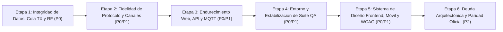

# Reporte de Verificación Multi-Agente y Plan de Remediación (`exploracion.md`)

> **Fecha de verificación:** 2026-10-24
> **Commit auditado en `exploracion.md`:** `c3b114c` (iniciado en `4ea20bf`)
> **Commit actual verificado (`HEAD`):** `2d98ebb` (`fix: address script and runtime audit findings`)
> **Modo de ejecución:** Estrictamente **solo lectura** sobre el código fuente, referencias oficiales y configuración. No se modificó ningún archivo de código ni se ejecutó `pytest`/Playwright/fuzzing (cumpliendo `AGENTS.md` §2 y §5).

---

## 1. Resumen Ejecutivo de la Verificación

Se desplegaron **5 agentes especializados** en paralelo (Debugging de Núcleo/Dominio, Investigación de Protocolo/Firmware, Auditoría de Seguridad Web/API, Calidad de Frontend/UI y Verificación de QA/Arquitectura) para contrastar cada afirmación de [exploracion.md](file:///c:/Users/Ruby/Desktop/meshcore-bridge/exploracion.md) contra el árbol real en `HEAD` (`2d98ebb`) y contra las referencias oficiales en [reference/meshcore](file:///c:/Users/Ruby/Desktop/meshcore-bridge/reference/meshcore), [reference/meshcore_py](file:///c:/Users/Ruby/Desktop/meshcore-bridge/reference/meshcore_py) y [reference/meshcore_cli](file:///c:/Users/Ruby/Desktop/meshcore-bridge/reference/meshcore_cli).

### 1.1 Veredicto Global sobre `exploracion.md`

El documento [exploracion.md](file:///c:/Users/Ruby/Desktop/meshcore-bridge/exploracion.md) es **riguroso y mayoritariamente exacto (~92 % de coincidencia directa con el código fuente)**, pero presenta **tres categorías de correcciones necesarias** al contrastarlo con `HEAD` (`2d98ebb`):

1. **Hallazgos ya corregidos en `2d98ebb` (posteriores a `c3b114c`):**
   - **`W-07` / `PST-03`** (mutación en memoria de presets MQTT inválidos antes de persistir): **Ya corregido** en [services_controller.py](file:///c:/Users/Ruby/Desktop/meshcore-bridge/src/web/controllers/services_controller.py#L96-L114) y [services_controller.py](file:///c:/Users/Ruby/Desktop/meshcore-bridge/src/web/controllers/services_controller.py#L395-L407) mediante `copy.deepcopy(cfg)`, validación estricta de enteros y commit transaccional previo.
   - **`W-15`** (rutas `/api/capabilities` y `/api/services/capabilities` ausentes del catálogo OpenAPI): **Ya corregido** en [asgi_route_catalog.py](file:///c:/Users/Ruby/Desktop/meshcore-bridge/src/web/asgi_route_catalog.py#L120-L121) y [asgi_openapi_catalog.py](file:///c:/Users/Ruby/Desktop/meshcore-bridge/src/web/asgi_openapi_catalog.py#L27-L38).
   - **Limitación de `check_layer_contracts.py`** (§10.3: solo inspeccionaba el `__init__.py` de paquetes fuente): **Ya corregida** en [check_layer_contracts.py](file:///c:/Users/Ruby/Desktop/meshcore-bridge/scripts/check_layer_contracts.py) al expandir recursivamente los submódulos con `_expand_source_modules`.
   - **Acoplamiento con `deploy/install.sh` en pruebas de instalador** (§4.3 #10–#12): **Parcialmente corregido** en [test_remaining_installer_audit.py](file:///c:/Users/Ruby/Desktop/meshcore-bridge/tests/test_remaining_installer_audit.py#L173) (`assert not DEPLOY_INSTALL_SH.exists()`).

2. **Imprecisiones técnicas en `exploracion.md` que cambian el diagnóstico o la solución:**
   - **`A-02` (Timeout TX de 408):** `exploracion.md` afirma que al expirar `asyncio.timeout(timeout)` *"no se cancela el future ni se retira el TxItem"*. **Corrección:** En CPython, `async with asyncio.timeout(timeout): res = await future` **sí invoca `future.cancel()`** automáticamente al salir con `CancelledError`, y [`TxRateLimiter._worker_loop`](file:///c:/Users/Ruby/Desktop/meshcore-bridge/src/rate_limiter.py#L783-L784) **sí descarta** ítems con `item.future.cancelled() == True` al desencolarlos. El defecto real es doble: (a) mientras no llega al frente de la cola sigue ocupando un slot de `MAX_QUEUE_SIZE=500`, y (b) si el timeout ocurre **después** de que el worker desencoló el ítem y mientras espera `await self.transmit_callback(item)` ([rate_limiter.py](file:///c:/Users/Ruby/Desktop/meshcore-bridge/src/rate_limiter.py#L804)), cancelar `item.future` **no aborta** la transmisión en curso y el paquete sale por RF tras haber devuelto HTTP 408.
   - **`W-03` y `W-04` (Bypass de controles de RF en administración y advert):** `exploracion.md:556` afirma que al usar `manual=True` *"solo queda el limitador global"*. **Corrección (más grave):** `run_sdk_command` ([sdk_commands.py](file:///c:/Users/Ruby/Desktop/meshcore-bridge/src/admin/sdk_commands.py#L12-L19) $\to$ [sdk_adapter.py](file:///c:/Users/Ruby/Desktop/meshcore-bridge/src/serial/sdk_adapter.py#L618-L633)) **tampoco pasa por `TxRateLimiter` ni por `AirtimeTracker`**, ni comprueba `is_cutoff_active()`. Además, en `W-03`, [`AdminHandler._handle`](file:///c:/Users/Ruby/Desktop/meshcore-bridge/src/admin_handler.py#L432) recalcula `req.manual = (manual_target is not None)` según el rol del nodo destino.
   - **`P-08` (`SensorMesh.cpp` de 1.18 "no reproducible offline"):** `exploracion.md:513, 1006` afirma que el commit `81dbae5` no está disponible localmente. **Corrección:** El tag `companion-v1.18.0` (`81dbae592ffad40b4212bc0b37e82b38da08f4bc`) **sí existe en la base `.git` local** de `reference/meshcore` y puede inspeccionarse offline (`git -C reference/meshcore show 81dbae5:examples/simple_sensor/SensorMesh.cpp`).
   - **`F03` / §12 (`region_scope` por canal en firmware):** `exploracion.md` asume que el firmware soporta scope por canal en `CMD_SET_CHANNEL` y que `transport_codes` mide 10 B. **Corrección:** En [MyMesh.cpp](file:///c:/Users/Ruby/Desktop/meshcore-bridge/reference/meshcore/examples/companion_radio/MyMesh.cpp#L514) existe `// TODO: have per-channel send_scope` y `CMD_SET_CHANNEL (32)` no lleva scope; las apps oficiales ([meshcore_cli.py](file:///c:/Users/Ruby/Desktop/meshcore-bridge/reference/meshcore_cli/src/meshcore_cli/meshcore_cli.py#L1927-L1938)) guardan el scope por canal en el cliente y envían `CMD_SET_FLOOD_SCOPE_KEY (54)` antes de transmitir. Además, `transport_codes` ocupa **4 bytes** (`uint16_t[2]` en [Packet.cpp](file:///c:/Users/Ruby/Desktop/meshcore-bridge/reference/meshcore/src/Packet.cpp#L74-L78)), no 10 bytes.
   - **`B-03` (Chat saliente publicado antes de confirmar TX):** En [bridge_core.py](file:///c:/Users/Ruby/Desktop/meshcore-bridge/src/bridge_core.py#L1322-L1325) solo se emite a la UI por WebSocket con `"status": "queued"` antes de transmitir; la publicación MQTT a `tx/status` ocurre después de transmitir ([bridge_core.py](file:///c:/Users/Ruby/Desktop/meshcore-bridge/src/bridge_core.py#L1398-L1400)).

3. **8 Nuevos Hallazgos Detectados por los Agentes durante la Verificación:**
   - Documentados en la **Sección 3** (`NEW-01` a `NEW-08`), incluyendo un `UnboundLocalError` potencial en `reset_counters`, doble evento MQTT `uncertain` + `sent` en timeouts de TX, trampa de 16 hex chars codificados como ASCII en `derive_channel_secret`, y error en el layout de request de `UNSUBSCRIBE (0x09)` en `PROTOCOL_SPEC.md`.

---

## 2. Verificación Detallada por Subsistema

### 2.1 Riesgos Altos (`§1.4` y `§11.2`)

| ID | Reclamo en `exploracion.md` | Veredicto | Evidencia en `HEAD` (`2d98ebb`) | Observaciones Técnicas de Verificación |
|---|---|---|---|---|
| **A-01** (`PST-04`, `LC-03`) | La importación desde radio deja `last_seen=0` y la limpieza periódica borra esos nodos persistiendo el borrado | **Confirmado (Exacto)** | [contacts.py](file:///c:/Users/Ruby/Desktop/meshcore-bridge/src/application/contacts.py#L408-L425), [contact_manager.py](file:///c:/Users/Ruby/Desktop/meshcore-bridge/src/contact_manager.py#L1072-L1085), [contact_manager.py](file:///c:/Users/Ruby/Desktop/meshcore-bridge/src/contact_manager.py#L1680-L1698), [bridge_core.py](file:///c:/Users/Ruby/Desktop/meshcore-bridge/src/bridge_core.py#L609-L622) | `sync_from_radio` pasa `last_seen=None`; `_build_updated_contact` asigna `eff_last_seen = 0.0` si no hay RSSI/SNR ni registro previo. Cada 60 s, `_cleanup_loop` evalúa `(now - 0.0) > 604800.0` (`True`), elimina los nodos importados y llama a `save_to_file` persistiendo el borrado en SQLite y JSON. |
| **A-02** | Al expirar el timeout de TX se devuelve 408 sin cancelar el future ni retirar el `TxItem` | **Parcialmente correcto (Matiz crítico)** | [messaging.py](file:///c:/Users/Ruby/Desktop/meshcore-bridge/src/application/messaging.py#L249-L258), [rate_limiter.py](file:///c:/Users/Ruby/Desktop/meshcore-bridge/src/rate_limiter.py#L783-L806) | `asyncio.timeout` **sí cancela** `future` al salir del bloque `await future`, y `_worker_loop` salta ítems con `future.cancelled()` al desencolarlos. **Pero:** (1) el ítem cancelado no se retira de `self.queue` hasta llegar al frente, y (2) si el worker **ya desencoló** el ítem y ejecuta `await self.transmit_callback(item)`, la transmisión en curso **no se cancela** y sale al aire tras haber devuelto 408. |
| **P-01** | Una PSK de 64 hex se deriva con `sha256(texto)[:16]` en vez de rechazarse | **Confirmado (Exacto)** | [shared_utils.py](file:///c:/Users/Ruby/Desktop/meshcore-bridge/src/shared_utils.py#L20-L29), [sdk_adapter.py](file:///c:/Users/Ruby/Desktop/meshcore-bridge/src/serial/sdk_adapter.py#L1821-L1832) vs [MyMesh.cpp](file:///c:/Users/Ruby/Desktop/meshcore-bridge/reference/meshcore/examples/companion_radio/MyMesh.cpp#L1718-L1725), [device.py](file:///c:/Users/Ruby/Desktop/meshcore-bridge/reference/meshcore_py/src/meshcore/commands/device.py#L218-L222) | `sdk_adapter.py:1821` permite `^[a-fA-F0-9]{0,64}$`. Si entran 64 hex chars (32 B), `derive_channel_secret` hace `sha256(clean_psk.encode("utf-8"))[:16]`. El firmware Companion (`CMD_SET_CHANNEL = 32`) rechaza secretos de 32 B con `ERR_CODE_UNSUPPORTED_CMD` y el SDK oficial exige exactamente 16 B (`32 hex`). |
| **W-01** | HTTP plano escuchando en `0.0.0.0` sin TLS ni HSTS | **Confirmado (Decisión de despliegue)** | [config.py](file:///c:/Users/Ruby/Desktop/meshcore-bridge/config.py#L161-L162), [asgi_server.py](file:///c:/Users/Ruby/Desktop/meshcore-bridge/src/web/asgi_server.py#L409-L430), [authentication.py](file:///c:/Users/Ruby/Desktop/meshcore-bridge/src/web/authentication.py#L220-L228), [access_policy.py](file:///c:/Users/Ruby/Desktop/meshcore-bridge/src/web/access_policy.py#L248-L255) | `WEB_HOST` por defecto es `"0.0.0.0"`, sin TLS nativo en Uvicorn, cookies con `secure=(scheme == "https")` y `response_headers()` nunca emite `Strict-Transport-Security`. |
| **W-03** (`B-04`, `LC-04`) | La administración REST usa `manual=True` y omite los cooldowns | **Parcialmente correcto (Riesgo RF mayor)** | [repeater_controller.py](file:///c:/Users/Ruby/Desktop/meshcore-bridge/src/web/controllers/repeater_controller.py#L29-L242), [admin_handler.py](file:///c:/Users/Ruby/Desktop/meshcore-bridge/src/admin_handler.py#L432), [repeater_executor.py](file:///c:/Users/Ruby/Desktop/meshcore-bridge/src/admin/repeater_executor.py#L980), [sdk_commands.py](file:///c:/Users/Ruby/Desktop/meshcore-bridge/src/admin/sdk_commands.py#L12-L19) | Los 12 endpoints pasan `manual=True`, lo que salta `can_ping`/`can_telemetry`/`can_cmd`/`can_traceroute` para repetidores/rooms conocidos. Además, `run_sdk_command` **no pasa por `TxRateLimiter` ni `AirtimeTracker`**. |
| **W-04** | `POST /api/node/advert` (y `/api/config/advert`) transmite sin cooldown ni cuota | **Confirmado (Exacto)** | [config_controller.py](file:///c:/Users/Ruby/Desktop/meshcore-bridge/src/web/controllers/config_controller.py#L183-L195), [admin_handler.py](file:///c:/Users/Ruby/Desktop/meshcore-bridge/src/admin_handler.py#L140-L150) | Llama directo a `run_sdk_command(..., "send_advert", flood=flood)` sin cooldown en `RepeaterManager`, sin `TxRateLimiter` y sin verificar `is_cutoff_active()`. |
| **U-01** | `viewport` sin `viewport-fit=cover` anula los `env(safe-area-inset-*)` | **Confirmado (Exacto)** | [index.html](file:///c:/Users/Ruby/Desktop/meshcore-bridge/src/web/static/index.html#L5) vs [app.css](file:///c:/Users/Ruby/Desktop/meshcore-bridge/src/web/static/css/app.css#L5126) | `<meta name="viewport" content="width=device-width, initial-scale=1.0">` carece de `viewport-fit=cover`, haciendo que `env(safe-area-inset-bottom)` valga `0` en iOS con notch. |

---

### 2.2 Núcleo, Dominio, Persistencia, MQTT y Ciclo de Vida (`§6.1`, `§6.2`, `§8`, `§11.3`, `§11.5`)

| ID | Veredicto | Evidencia en `HEAD` (`2d98ebb`) | Notas de Verificación |
|---|---|---|---|
| **M-01** | **Confirmado** | [contact_manager.py](file:///c:/Users/Ruby/Desktop/meshcore-bridge/src/contact_manager.py#L910-L914), [rx_router.py](file:///c:/Users/Ruby/Desktop/meshcore-bridge/src/rx_router.py#L1056) | `is_local_key("")` devuelve `True`; remitentes vacíos/no resueltos se descartan como eco propio. |
| **M-02** | **Confirmado** | [channels.py](file:///c:/Users/Ruby/Desktop/meshcore-bridge/src/application/channels.py#L284), [channels.py](file:///c:/Users/Ruby/Desktop/meshcore-bridge/src/application/channels.py#L312-L314) vs [sdk_adapter.py](file:///c:/Users/Ruby/Desktop/meshcore-bridge/src/serial/sdk_adapter.py#L664) | Compara `res.get("status") == "error"` pero el adaptador retorna `"ERROR"`; `delete_channel` ignora el retorno de `ser.delete_channel(index)`. |
| **M-03** | **Confirmado** | [channels.py](file:///c:/Users/Ruby/Desktop/meshcore-bridge/src/application/channels.py#L322-L333) | `update_from_system_event` muta `self._channels` sin `_mutation_lock`, sin `_dirty = True` y sin `psk`/`is_public`. |
| **M-04** | **Confirmado** | [rx_router.py](file:///c:/Users/Ruby/Desktop/meshcore-bridge/src/rx_router.py#L913-L930), [config.py](file:///c:/Users/Ruby/Desktop/meshcore-bridge/config.py#L109) | Sin `sender_timestamp`, deduplica por `sender + channel_idx + text + txt_type` durante 60 s, bloqueando respuestas cortas idénticas (`"ok"`). |
| **M-05** (`MQ-01`) | **Confirmado** | [rx_router.py](file:///c:/Users/Ruby/Desktop/meshcore-bridge/src/rx_router.py#L1045-L1048), [rx_router.py](file:///c:/Users/Ruby/Desktop/meshcore-bridge/src/rx_router.py#L1469-L1486), [bridge_core.py](file:///c:/Users/Ruby/Desktop/meshcore-bridge/src/bridge_core.py#L278-L283) | Publica en `self.topics.rx_all` antes de `publish_chat_event` (donde se filtra eco/repetidor y se persiste en SQLite). |
| **M-06** | **Confirmado** | [config_controller.py](file:///c:/Users/Ruby/Desktop/meshcore-bridge/src/web/controllers/config_controller.py#L134-L136), [rate_limiter.py](file:///c:/Users/Ruby/Desktop/meshcore-bridge/src/rate_limiter.py#L570-L585) | No valida `airtime_cutoff_resume_pct < airtime_cutoff_threshold_pct`, permitiendo oscilación de cutoff. |
| **M-07** | **Confirmado** | [contacts.py](file:///c:/Users/Ruby/Desktop/meshcore-bridge/src/application/contacts.py#L162), [contact_manager.py](file:///c:/Users/Ruby/Desktop/meshcore-bridge/src/contact_manager.py#L1563-L1570) | `create_or_update_contact` acepta `ROOM` y `SENSOR`, pero `list_client_contacts()` solo devuelve `CLIENT`. |
| **M-08** | **Confirmado** | [channels.py](file:///c:/Users/Ruby/Desktop/meshcore-bridge/src/application/channels.py#L198-L210) vs [sdk_adapter.py](file:///c:/Users/Ruby/Desktop/meshcore-bridge/src/serial/sdk_adapter.py#L1810-L1817) | Capacidad de canales con fallback `8` en servicio vs `16` en adaptador. |
| **B-01** (`LC-05`) | **Confirmado** | [bridge_core.py](file:///c:/Users/Ruby/Desktop/meshcore-bridge/src/bridge_core.py#L418-L423) | `self._bg_queue.popleft()` descarta sin log ni contador cuando llega a 500 ítems. |
| **B-02** (`LC-02`) | **Confirmado** | [tcp_companion_server.py](file:///c:/Users/Ruby/Desktop/meshcore-bridge/src/tcp_companion_server.py#L428-L433), [bridge_core.py](file:///c:/Users/Ruby/Desktop/meshcore-bridge/src/bridge_core.py#L495) | `_transaction_lock` serializa el servidor TCP Companion hasta 30 s. |
| **B-03** | **Parcialmente correcto** | [bridge_core.py](file:///c:/Users/Ruby/Desktop/meshcore-bridge/src/bridge_core.py#L1322-L1325), [bridge_core.py](file:///c:/Users/Ruby/Desktop/meshcore-bridge/src/bridge_core.py#L1384-L1400) | Antes de TX solo se emite al WS con `"status": "queued"` para la UI; MQTT `tx/status` se publica tras completar `send_message`. |
| **B-05..B-11** | **Confirmados** | [channels.py](file:///c:/Users/Ruby/Desktop/meshcore-bridge/src/application/channels.py#L275-L285), [contact_manager.py](file:///c:/Users/Ruby/Desktop/meshcore-bridge/src/contact_manager.py#L918), [repeater_handler.py](file:///c:/Users/Ruby/Desktop/meshcore-bridge/src/routers/repeater_handler.py#L163-L167), [repeater_manager.py](file:///c:/Users/Ruby/Desktop/meshcore-bridge/src/repeater_manager.py#L230-L238), [protocol_types.py](file:///c:/Users/Ruby/Desktop/meshcore-bridge/src/protocol_types.py#L828-L845), [config.py](file:///c:/Users/Ruby/Desktop/meshcore-bridge/config.py#L235), [rate_limiter.py](file:///c:/Users/Ruby/Desktop/meshcore-bridge/src/rate_limiter.py#L397-L420) | Todos verificados en las líneas actuales indicadas. |
| **PST-01 / PST-02** | **Confirmados** | [station_database.py](file:///c:/Users/Ruby/Desktop/meshcore-bridge/src/station_database.py#L132-L180), [station_database.py](file:///c:/Users/Ruby/Desktop/meshcore-bridge/src/station_database.py#L338-L343) | Sin purga/retención en `messages`/`documents` y sin migraciones incrementales entre versiones de esquema. |
| **PST-03** (`W-07`) | **Ya corregido en `2d98ebb`** | [services_controller.py](file:///c:/Users/Ruby/Desktop/meshcore-bridge/src/web/controllers/services_controller.py#L96-L114), [services_controller.py](file:///c:/Users/Ruby/Desktop/meshcore-bridge/src/web/controllers/services_controller.py#L396-L406) | Resuelto en `2d98ebb` (`D06`): valida y persiste sobre `copy.deepcopy(cfg)` antes de mutar `current.custom_presets`. |
| **F02** (§11.5) | **Confirmado** | [bridge_core.py](file:///c:/Users/Ruby/Desktop/meshcore-bridge/src/bridge_core.py#L280), [rx_router.py](file:///c:/Users/Ruby/Desktop/meshcore-bridge/src/rx_router.py#L1095-L1106) | `publish_chat_event` reevalúa `is_common_chat_message` ya filtrado en el router. |
| **§6.2 (9 descartes)** | **Confirmados como falsos positivos bien descartados** | [bridge_core.py](file:///c:/Users/Ruby/Desktop/meshcore-bridge/src/bridge_core.py#L497), [rate_limiter.py](file:///c:/Users/Ruby/Desktop/meshcore-bridge/src/rate_limiter.py#L110), [station_database.py](file:///c:/Users/Ruby/Desktop/meshcore-bridge/src/station_database.py#L112), [messaging.py](file:///c:/Users/Ruby/Desktop/meshcore-bridge/src/application/messaging.py#L179-L191) | Los 9 puntos descartados en §6.2 están efectivamente bien protegidos en el código. |

---

### 2.3 Protocolo, Firmware y Paridad Funcional (`§6.3`, `§11.3`, `§11.5`, `§12`)

| ID | Veredicto | Evidencia (`src/` + `reference/`) | Notas de Verificación |
|---|---|---|---|
| **P-02** | **Confirmado** | [shared_utils.py](file:///c:/Users/Ruby/Desktop/meshcore-bridge/src/shared_utils.py#L20-L29) vs [device.py](file:///c:/Users/Ruby/Desktop/meshcore-bridge/reference/meshcore_py/src/meshcore/commands/device.py#L215-L216), [meshcore_cli.py](file:///c:/Users/Ruby/Desktop/meshcore-bridge/reference/meshcore_cli/src/meshcore_cli/meshcore_cli.py#L2922-L2924) | Cuando `psk=""` en canal sin `#`, `derive_channel_secret` retorna `b"\x00"*16` (slot vacío en firmware), mientras que SDK y CLI oficiales derivan `sha256(name.encode("utf-8")).digest()[:16]`. |
| **P-03** | **Confirmado** | [traceroute_executor.py](file:///c:/Users/Ruby/Desktop/meshcore-bridge/src/admin/traceroute_executor.py#L79-L82), [traceroute_executor.py](file:///c:/Users/Ruby/Desktop/meshcore-bridge/src/admin/traceroute_executor.py#L169-L214) vs [MyMesh.cpp](file:///c:/Users/Ruby/Desktop/meshcore-bridge/reference/meshcore/examples/companion_radio/MyMesh.cpp#L1764-L1770) | `_format_trace_hops` trunca silenciosamente hashes de 6 hex (3 B, no soportados por `path_sz`) o pubkeys resueltas a `clean_hex[:4]` (2 B). |
| **P-04** | **Confirmado (y ampliado)** | [PROTOCOL_SPEC.md](file:///c:/Users/Ruby/Desktop/meshcore-bridge/docs/PROTOCOL_SPEC.md#L561-L563) vs [repeater_executor.py](file:///c:/Users/Ruby/Desktop/meshcore-bridge/src/admin/repeater_executor.py#L425-L435) y `SensorMesh.cpp` (`81dbae5`) | El código es correcto; `PROTOCOL_SPEC.md` está mal tanto en la respuesta (`[err_code]` de 1 B en línea 563) como en el request (`[0x09][push_tag (4B)]` en línea 562, cuando el firmware real usa `[0x09]` de 1 B). |
| **P-05..P-07** | **Confirmados** | [protocol_types.py](file:///c:/Users/Ruby/Desktop/meshcore-bridge/src/protocol_types.py#L30), [raw_framing.py](file:///c:/Users/Ruby/Desktop/meshcore-bridge/src/serial/raw_framing.py#L19-L20), [sdk_adapter.py](file:///c:/Users/Ruby/Desktop/meshcore-bridge/src/serial/sdk_adapter.py#L1601-L1605), [shared_utils.py](file:///c:/Users/Ruby/Desktop/meshcore-bridge/src/shared_utils.py#L47-L53) | Confirmados. Nota menor: el archivo es `src/serial/raw_framing.py`, no en raíz. |
| **P-08** | **Parcialmente correcto** | [PROTOCOL_SPEC.md](file:///c:/Users/Ruby/Desktop/meshcore-bridge/docs/PROTOCOL_SPEC.md#L515), [PROTOCOL_SPEC.md](file:///c:/Users/Ruby/Desktop/meshcore-bridge/docs/PROTOCOL_SPEC.md#L553) | El working tree de `reference/meshcore` está en `d9296435` (1.17.1), pero el tag `companion-v1.18.0` (`81dbae5`) **sí existe en el `.git` local** y es verificable offline. Solo falta aclararlo en `PROTOCOL_SPEC.md:553`. |
| **F01** (§11.5) | **Confirmado** | [utils.js](file:///c:/Users/Ruby/Desktop/meshcore-bridge/src/web/static/js/core/utils.js#L408), [chat.js](file:///c:/Users/Ruby/Desktop/meshcore-bridge/src/web/static/js/modules/chat.js#L1868) vs [sdk_adapter.py](file:///c:/Users/Ruby/Desktop/meshcore-bridge/src/serial/sdk_adapter.py#L1600-L1605) | El frontend valida 160 B fijos sin descontar `len(sender_name) + 2` en canales, provocando rechazos en mensajes de `160 - prefix_len + 1 .. 160` B. |
| **F03 / §12 (`region_scope`)** | **Parcialmente correcto** | [channels_controller.py](file:///c:/Users/Ruby/Desktop/meshcore-bridge/src/web/controllers/channels_controller.py#L224-L230) vs [MyMesh.cpp](file:///c:/Users/Ruby/Desktop/meshcore-bridge/reference/meshcore/examples/companion_radio/MyMesh.cpp#L514), [meshcore_cli.py](file:///c:/Users/Ruby/Desktop/meshcore-bridge/reference/meshcore_cli/src/meshcore_cli/meshcore_cli.py#L1927-L1938) | El scope por canal no existe en `CMD_SET_CHANNEL` del firmware; el cliente oficial guarda el scope por canal localmente y llama a `CMD_SET_FLOOD_SCOPE_KEY (54)` antes de enviar. `transport_codes` son 4 B (`uint16_t[2]`), no 10 B. |

---

### 2.4 Web, API, WebSocket y Seguridad (`§7` y `§11.3`)

| ID | Veredicto | Evidencia en `HEAD` (`2d98ebb`) | Notas de Verificación |
|---|---|---|---|
| **W-02** | **Confirmado (Diseño)** | [authentication.py](file:///c:/Users/Ruby/Desktop/meshcore-bridge/src/web/authentication.py#L154-L192), [access_policy.py](file:///c:/Users/Ruby/Desktop/meshcore-bridge/src/web/access_policy.py#L26-L49) | Autorización binaria sin scopes `read`/`tx`/`admin`. Además, `PROTECTED_PREFIXES` y `SENSITIVE_READ_PATHS` en `access_policy.py:26-49` son constantes muertas no conectadas. |
| **W-05** | **Confirmado** | [services_controller.py](file:///c:/Users/Ruby/Desktop/meshcore-bridge/src/web/controllers/services_controller.py#L462-L520), [external_mqtt_client.py](file:///c:/Users/Ruby/Desktop/meshcore-bridge/src/external_mqtt_client.py#L144-L151) | SSRF TCP (con `latency_ms`) y lectura arbitraria de `tls_ca_file` en `POST /api/services/mqtt-external/test`. |
| **W-06** (`MQ-04`) | **Confirmado** | [external_mqtt_client.py](file:///c:/Users/Ruby/Desktop/meshcore-bridge/src/external_mqtt_client.py#L148-L150) | `tls_verify=False` desactiva `check_hostname` y pone `ssl.CERT_NONE`. |
| **W-07** (`PST-03`) | **Ya corregido en `2d98ebb`** | [services_controller.py](file:///c:/Users/Ruby/Desktop/meshcore-bridge/src/web/controllers/services_controller.py#L96-L114), [services_controller.py](file:///c:/Users/Ruby/Desktop/meshcore-bridge/src/web/controllers/services_controller.py#L324-L334) | Cerrado en `2d98ebb` (`D06`). |
| **W-08** | **Confirmado (Hipótesis de carga)** | [asgi_ws_hub.py](file:///c:/Users/Ruby/Desktop/meshcore-bridge/src/web/asgi_ws_hub.py#L245-L263), [authentication.py](file:///c:/Users/Ruby/Desktop/meshcore-bridge/src/web/authentication.py#L194-L199) | Revalida la sesión en SQLite (`asyncio.to_thread`) por cada peer en cada broadcast WS. |
| **W-09..W-14** | **Confirmados** (matiz en `W-10`) | [authentication.py](file:///c:/Users/Ruby/Desktop/meshcore-bridge/src/web/authentication.py#L101-L102), [logs_controller.py](file:///c:/Users/Ruby/Desktop/meshcore-bridge/src/web/controllers/logs_controller.py#L22-L28), [logs_controller.py](file:///c:/Users/Ruby/Desktop/meshcore-bridge/src/web/controllers/logs_controller.py#L122-L139), [mqtt_dispatcher.py](file:///c:/Users/Ruby/Desktop/meshcore-bridge/src/mqtt_dispatcher.py#L306-L308), [bridge_core.py](file:///c:/Users/Ruby/Desktop/meshcore-bridge/src/bridge_core.py#L1417-L1420) | En `W-10`, `str(error)` solo expone mensajes de validación propios de `validate_credentials`, no trazas SQLite. `W-11` (`limit` sin cota y ruta absoluta de log) y `W-14` (texto de chat en logs `INFO`) confirmados. |
| **W-15** | **Ya corregido en `2d98ebb`** | [asgi_route_catalog.py](file:///c:/Users/Ruby/Desktop/meshcore-bridge/src/web/asgi_route_catalog.py#L120-L121), [asgi_openapi_catalog.py](file:///c:/Users/Ruby/Desktop/meshcore-bridge/src/web/asgi_openapi_catalog.py#L27-L38) | Cerrado en `2d98ebb`. |
| **W-16..W-23** | **Confirmados** | [map_tile_service.py](file:///c:/Users/Ruby/Desktop/meshcore-bridge/src/web/map_tile_service.py#L145-L146), [admin_handler.py](file:///c:/Users/Ruby/Desktop/meshcore-bridge/src/admin_handler.py#L440-L452), [repeater_executor.py](file:///c:/Users/Ruby/Desktop/meshcore-bridge/src/admin/repeater_executor.py#L1803), [services_controller.py](file:///c:/Users/Ruby/Desktop/meshcore-bridge/src/web/controllers/services_controller.py#L380-L381), [mqtt_dispatcher.py](file:///c:/Users/Ruby/Desktop/meshcore-bridge/src/mqtt_dispatcher.py#L178-L208) | Confirmado `W-19` (destino desconocido de 64 hex se da de alta como repetidor `node_type = 2` en la radio y transmite) y `W-22` (`topic_prefix`/`region_iata` sin validar comodines `+`/`#`). |
| **§7.7 (16 descartes)** | **Confirmados como falsos positivos** | [authentication.py](file:///c:/Users/Ruby/Desktop/meshcore-bridge/src/web/authentication.py#L415-L420), [auth_store.py](file:///c:/Users/Ruby/Desktop/meshcore-bridge/src/web/auth_store.py#L49-L53), [asgi_assets.py](file:///c:/Users/Ruby/Desktop/meshcore-bridge/src/web/asgi_assets.py#L65-L79), [external_mqtt_client.py](file:///c:/Users/Ruby/Desktop/meshcore-bridge/src/external_mqtt_client.py#L381-L383) | CSRF, `scrypt`, anti-fuerza bruta persistido, allowlist de comandos de firmware, anti-path-traversal y anti-loop MQTT verificados en código. |

---

### 2.5 Frontend, Uniformidad Visual, Responsive y WCAG (`§1.5` y `§9`)

Ningún archivo bajo `src/web/static/` cambió entre `c3b114c` y `2d98ebb`.

- **Confirmados íntegramente (`U-01`..`U-15`, `U-17`, `U-20`..`U-30`, `U-32`..`U-34`):**
  - **`U-03`:** [`readDensityPreference()`](file:///c:/Users/Ruby/Desktop/meshcore-bridge/src/web/static/js/core/theme.js#L26-L36) devuelve siempre `"compact"` y `applyDensityPreference()` ignora el argumento recibido.
  - **`U-04`:** El script inline de [index.html](file:///c:/Users/Ruby/Desktop/meshcore-bridge/src/web/static/index.html#L16-L27) fija `data-bs-theme="light"`, pero [app.css](file:///c:/Users/Ruby/Desktop/meshcore-bridge/src/web/static/css/app.css#L426-L469) exige `body.light-theme` (aplicado después por módulo ES), causando FOUC en tema claro.
  - **`U-05`:** El bloque anti-zoom iOS (`font-size: 16px !important` en [app.css](file:///c:/Users/Ruby/Desktop/meshcore-bridge/src/web/static/css/app.css#L5817-L5874)) solo cubre `max-width: 767.98px`.
  - **`U-06`:** `.btn-header-action` (`#themeToggleBtn`) mide `32×32 px` en escritorio ([app.css](file:///c:/Users/Ruby/Desktop/meshcore-bridge/src/web/static/css/app.css#L619-L664)) y `34×34 px` en móvil ([app.css](file:///c:/Users/Ruby/Desktop/meshcore-bridge/src/web/static/css/app.css#L5969-L5983)), haciendo fallar `test_web_mobile_viewport_matrix.py:422` (que exige $\ge 36\text{ px}$).
  - **`U-34`:** Verificado matemáticamente desde el CSS: en tema claro, `#logsCountBadge.badge-outline` ([index.html](file:///c:/Users/Ruby/Desktop/meshcore-bridge/src/web/static/index.html#L728)) usa `--bs-secondary-color` (`#475569`) sobre `.linux-term-header` (`rgba(15,23,42,0.65)` compuesto sobre `#1e293b` $\to$ `#141d30`), resultando en un contraste exacto de **2,21:1** (< 4,5:1 WCAG AA), causa real del fallo en `test_wcag_contrast_audit.py:265`.
- **Precisiones de conteo estático (`U-16`, `U-18`, `U-19`, §9.1):**
  - [app.css](file:///c:/Users/Ruby/Desktop/meshcore-bridge/src/web/static/css/app.css) tiene **6.913 líneas totales** y **6.105 líneas no vacías** (`exploracion.md` reportó las líneas no vacías como total, aunque citó líneas hasta la `6881`).
  - Colores hexadecimales en `app.css`: **230 totales** (172 fuera de los bloques `:root`/`[data-bs-theme="light"]`, 118 fuera de declaraciones `--*`).
  - `border-radius`: **42** valores literales distintos en propiedades `border*-radius` (44 incluyendo variables `--*radius*`).
  - Variables `--*` únicas (**145**), usos de `var(--*)` (**1.327**), `!important` (**226**), `box-shadow` distintos (**45**), `@media` (**29**), `font-size` declarados (**238**, 3 en `px`) e IDs en `index.html` (**663**, 0 duplicados): **100 % exactos**.

---

### 2.6 Estado de Pruebas, Entorno, Gates Estáticos y Arquitectura (`§2`, `§4`, `§5`, `§10`, `§15`)

1. **Deriva del entorno `.venv` (§2.3):** **100 % confirmada**. Las discrepancias de versiones instaladas en `.venv` frente a `pyproject.toml` / `requirements*.txt` coinciden exactamente (`meshcore 2.3.15` vs `2.3.17`, `pydantic 2.14.0` vs `2.14.1`, `websockets 17.2` vs `17.3`, `cryptography 50.0.0` vs `50.0.2`, `mypy 2.3.1` vs `2.4.0`, `ruff 0.16.3` vs `0.17.1`, `playwright 1.62.0` vs `1.64.0`, más `setuptools 84.0.0` vs `84.2.1`).
2. **Gates estáticos ejecutados en `HEAD` (`2d98ebb`):**
   - `ruff check src tests scripts` $\to$ **OK** (`All checks passed!`).
   - `mypy --strict src` $\to$ **OK** (`Success: no issues found in 97 source files`).
   - `scripts/check_layer_contracts.py` $\to$ **OK** (`Static import contracts: 2 checked, 0 violations`).
   - `scripts/validate_project_docs.py` $\to$ **OK** (`Documentation structure: 132 files checked; 0 issues`).
   - `node scripts/check_frontend_syntax.cjs` $\to$ **OK** (`25 files, 0 failures`).
   - `node scripts/build_frontend.cjs --check` $\to$ **OK** (`Verified 33 assets`).
   - `bandit -r src -ll -ii` $\to$ **OK** (`No issues identified`).
   - `.agents/skills/async-concurrency-engineering/scripts/audit_async_concurrency.py` $\to$ **OK** (`100% de conformidad`).
   - `.agents/skills/contract-openapi-sync/scripts/verify_api_parity.py` $\to$ **Exit 1** (`4 llamadas no coinciden`: `/api/auth/session` en `websocket.js`/`.min.js` y `session_startup.js`/`.min.js`, falso positivo porque la ruta se registra en `authentication.py:336` y el script solo escanea `api_router.py`).
3. **Verificación estática de los 16 fallos de `pytest` (§4.3) y evidencia en `tests/artifacts/`:**
   - Los 7 archivos de evidencia citados en §15.2 (`pytest_partial_before_hang.log`, `hang_isolated.log`, `junit2.xml`, `pytest_full2.log`, `junit_rerun.xml`, `pytest_rerun.log`, `visual-styles/contrast-light-390.json`) **existen en `tests/artifacts/`** y respaldan las tablas de §4.
   - Se confirma en [pyproject.toml](file:///c:/Users/Ruby/Desktop/meshcore-bridge/pyproject.toml#L40-L83) y [requirements-dev.txt](file:///c:/Users/Ruby/Desktop/meshcore-bridge/requirements-dev.txt) que **`pytest-timeout` no está instalado ni configurado**.
   - Se confirma leyendo cada test y el código de producción que **2 fallos corresponden a defectos reales de UI** (`U-06` en [test_web_mobile_viewport_matrix.py](file:///c:/Users/Ruby/Desktop/meshcore-bridge/tests/test_web_mobile_viewport_matrix.py#L422) y `U-34` en [test_wcag_contrast_audit.py](file:///c:/Users/Ruby/Desktop/meshcore-bridge/tests/test_wcag_contrast_audit.py#L265)) y **11 casos son pruebas obsoletas o acopladas a contratos antiguos**:
     - `#1` `test_audit_2026_10_18::test_remediated_web02_ingress_inspector_inspects_query_string` vs [security_inspector.py](file:///c:/Users/Ruby/Desktop/meshcore-bridge/src/web/security_inspector.py#L168-L184) (`clean_path = path.split("?")[0]`).
     - `#2` `test_auth_startup_browser::test_login_reflows_with_conditional_setup_help` vs [authentication.py](file:///c:/Users/Ruby/Desktop/meshcore-bridge/src/web/authentication.py#L201-L203) (`requires_initial_setup: False` para anónimos).
     - `#3, #4 (y #5)` `test_chat_reading_browser` vs [chat.js](file:///c:/Users/Ruby/Desktop/meshcore-bridge/src/web/static/js/modules/chat.js#L2000-L2004) (`seed_history` no activa `tab-chat`, dejando `feed.clientHeight == 0`).
     - `#8` `test_login_browser_audit::test_login_fits_viewports_themes_languages_and_feedback` vs [app.css](file:///c:/Users/Ruby/Desktop/meshcore-bridge/src/web/static/css/app.css#L351) y [app.css](file:///c:/Users/Ruby/Desktop/meshcore-bridge/src/web/static/css/app.css#L408) (exige `rgb(36, 87, 214)` en ambos temas; nota: `#2457d6` es el valor de tema **oscuro** y `#1d4ed8` el de tema **claro**, al revés de lo escrito en la nota de `exploracion.md`).
     - `#9–#13` (5 casos en `test_meshcore_1_18_firmware_cli_browser`) vs [settings.js](file:///c:/Users/Ruby/Desktop/meshcore-bridge/src/web/static/js/modules/settings.js#L1672-L1674) (interceptan `GET /api/config` cuando `fetchLocalNodeConfig(true)` ahora usa `POST /api/config/refresh`).
     - `#14` `test_playwright_e2e_simulation::test_playwright_delivery_ack_and_echo` vs [chat.js](file:///c:/Users/Ruby/Desktop/meshcore-bridge/src/web/static/js/modules/chat.js#L1749-L1751) (espera texto `"✓✓"` pero ahora se renderiza `<i class="bi bi-check-all">`).
4. **Métricas arquitectónicas (§10.2) y cobertura de módulos (§5.2):**
   - `src/` mantiene **97 módulos**, **63 funciones > 80 líneas**, función más larga `repeater_executor._execute_batch_config` (**288 líneas**), y **6 `# type: ignore`**. En `2d98ebb`, `bridge_core.py` subió de `1.670` a **1.705 líneas** (`getattr(` subió de 112 a **124**) y `asgi_openapi_catalog.py` de `939` a **951 líneas**.
   - `tests/` subió de `142` a **147 archivos `tests/*.py`** (`1.078` funciones `test_`, `23.512` líneas) en `2d98ebb` por los 5 módulos `tests/test_deep_*.py`, los cuales ya cubren `application.capabilities` y `command_policy`/`CommandLedger` (que figuraban como sin pruebas `N` en §5.2).

---

## 3. Nuevos Hallazgos Detectados durante la Verificación (`NEW-01`..`NEW-08`)

Además de verificar `exploracion.md`, los agentes identificaron 8 defectos/discrepancias adicionales en `HEAD` (`2d98ebb`):

| ID | Severidad | Ubicación (`HEAD`) | Descripción |
|---|---|---|---|
| **NEW-01** | Media | [bridge_core.py](file:///c:/Users/Ruby/Desktop/meshcore-bridge/src/bridge_core.py#L574-L584) | `UnboundLocalError` potencial en `MeshCoreBridge.reset_counters`: `res` solo se asigna dentro del `if hasattr(self, "node_registry") and hasattr(self.node_registry, "reset_analytics"):`, pero la línea 584 hace `return res` incondicionalmente. |
| **NEW-02** | Media | [mqtt_dispatcher.py](file:///c:/Users/Ruby/Desktop/meshcore-bridge/src/mqtt_dispatcher.py#L342-L353) + [bridge_core.py](file:///c:/Users/Ruby/Desktop/meshcore-bridge/src/bridge_core.py#L1398-L1400) | Si expira el timeout de 30 s en `_handle_tx_request` mientras el worker ya transmite, `mqtt_dispatcher` marca el ledger como `UNCERTAIN` y publica `"status": "uncertain"` en `meshcore/tx/status`; al terminar la TX, `_execute_tx` publica un segundo evento `"status": "sent"` con el mismo `request_id`. |
| **NEW-03** | Baja | [bridge_core.py](file:///c:/Users/Ruby/Desktop/meshcore-bridge/src/bridge_core.py#L1168-L1197) | La rama fallback de `_auto_bootstrap_heltec_state` (cuando `contact_service is None`) marca todos los contactos importados como `is_favorite=True`, no filtra `is_local_key(pk)` y no persiste al finalizar. |
| **NEW-04** | Media | [shared_utils.py](file:///c:/Users/Ruby/Desktop/meshcore-bridge/src/shared_utils.py#L26-L27) + [sdk_adapter.py](file:///c:/Users/Ruby/Desktop/meshcore-bridge/src/serial/sdk_adapter.py#L1821) | Si un usuario introduce una PSK de **16 caracteres hexadecimales** (pensando en 64 bits), pasa el regex `^[a-fA-F0-9]{0,64}$` y cae en `if len(clean_psk) == 16: return clean_psk.encode("utf-8")`, usando los bytes ASCII del texto hex como clave AES-128. |
| **NEW-05** | Baja | [sdk_adapter.py](file:///c:/Users/Ruby/Desktop/meshcore-bridge/src/serial/sdk_adapter.py#L73) vs `MyMesh.cpp:1951` (`81dbae5`) | `_COMPANION_MIN_LENGTHS[66]` (`CMD_RUN_CLI_COMMAND`) define longitud mínima `2`, pero el firmware Companion exige `len >= 3` (`[0x42][tag][cmd...]`). |
| **NEW-06** | Baja | [traceroute_executor.py](file:///c:/Users/Ruby/Desktop/meshcore-bridge/src/admin/traceroute_executor.py#L175-L214) | Cuando `_format_trace_hops` resuelve un repetidor por nombre/pubkey completa, fuerza `clean_hex[:4]` (2 B) sin respetar la longitud de otros hops explícitos (1 B o 4 B) en la misma ruta, lanzando `ValueError` en la línea 212. |
| **NEW-07** | Baja (Docs) | [PROTOCOL_SPEC.md](file:///c:/Users/Ruby/Desktop/meshcore-bridge/docs/PROTOCOL_SPEC.md#L562) | Además de la respuesta de `UNSUBSCRIBE (0x09)` (`P-04`), la línea 562 documenta el request como `[0x09 (1B)][push_tag (4B)] (5 bytes)`, cuando firmware y bridge envían solo `[0x09]` (1 byte). |
| **NEW-08** | Baja | [access_policy.py](file:///c:/Users/Ruby/Desktop/meshcore-bridge/src/web/access_policy.py#L26-L49) | `PROTECTED_PREFIXES` y `SENSITIVE_READ_PATHS` están declaradas pero nunca son referenciadas en el control de acceso real. |

---

## 4. Decisiones Obligatorias del Usuario Antes de Implementar (Checklist LoRa `AGENTS.md` §4)

De acuerdo con `AGENTS.md` §4 (**NUNCA elegir un límite, umbral o intervalo de forma unilateral**), antes de ejecutar los pasos de las Etapas 1, 2 y 6 que tocan transmisión RF, timers o políticas de exposición, el usuario debe definir:

1. **Intervalo mínimo de cooldown para `POST /api/config/advert` y `/api/node/advert` (`W-04`)** y si el cooldown debe distinguir entre `Zero-Hop` y `Flood`.
2. **Política de cooldown en acciones administrativas manuales (`W-03`)**: ¿Qué intervalo mínimo por repetidor debe aplicarse desde la WebUI/REST para `ping`, `telemetry`, `req_neighbours`, `traceroute` y `cmd`, y si el operador puede forzarlo explícitamente (`force=true`)?
3. **Contrato de timeout en `MessageService.submit_chat` (`A-02`)**: Cuando la cola TX supera el tiempo de espera, ¿prefiere **(Opción A)** cancelar el `TxItem` si aún no se transmitió y devolver `408`, o **(Opción B)** devolver `202 Accepted (queued)` manteniendo el ítem en cola sin duplicar envíos?
4. **Modelo de exposición de red (`W-01`)**: ¿Cambiar `WEB_HOST` por defecto a `127.0.0.1` exigiendo configuración explícita para LAN, o mantener `0.0.0.0` con advertencia visible cuando no haya TLS/proxy?
5. **Política de retención de SQLite (`PST-01`)**: ¿Cuántos días o máximo de filas deben conservarse en la tabla `messages` antes de purgar?

---

## 5. Plan de Solución por Etapas, Agentes Responsables y Skills

El plan se estructura en **6 etapas secuenciales** ordenadas por criticidad operativa, asignando para cada tarea el **Agente oficial de `AGENTS.md` §2**, las **Skills de `.agents/skills/`** y los archivos propietarios para evitar conflictos de edición concurrente.

---

### Etapa 1 — Integridad de Datos, Cola de Transmisión y Protección de Airtime (Prioridad P0)

**Objetivo:** Impedir la pérdida automática de contactos sincronizados desde la radio (`A-01`), eliminar transmisiones huérfanas/duplicadas tras timeout (`A-02`, `NEW-02`), someter los anuncios y comandos admin al control de airtime/cooldown persistido (`W-03`, `W-04`) y cerrar los defectos de estado en el core (`M-01`..`M-06`, `NEW-01`, `NEW-03`).

| Tarea | Hallazgos cubiertos | Agente Responsable (`AGENTS.md`) | Skills Asignadas | Archivos a Modificar | Acción Técnica Concreta |
|---|---|---|---|---|---|
| **1.1** | **A-01** (`PST-04`, `LC-03`), **NEW-03** | **Agente 2**: Python Bridge Architect Agent | `systematic-debugging`, `python-patterns-typing` | `src/contact_manager.py`, `src/application/contacts.py`, `src/bridge_core.py` | 1) En `NodeRegistry.cleanup_inactive`, no purgar nodos con `last_seen <= 0` o sellar `last_seen = now` al importar desde la flash conservando `last_advert` separado. 2) Unificar la rama fallback de `_auto_bootstrap_heltec_state` con `ContactService.sync_from_radio`. |
| **1.2** | **A-02**, **NEW-02** | **Agente 2**: Python Bridge Architect Agent | `async-concurrency-engineering`, `diagnosing-bugs` | `src/application/messaging.py`, `src/rate_limiter.py`, `src/mqtt_dispatcher.py` | 1) En `TxRateLimiter`, proveer cancelación explícita por `request_id`/`TxItem` que retire o invalide el ítem antes de llamar a `transmit_callback`, e impida despachar si el cliente ya expiró. 2) Si el ítem ya entró en `transmit_callback` cuando vence el timeout, devolver estado coherente (`202`/`uncertain`) y evitar la doble publicación `uncertain` + `sent` en `meshcore/tx/status`. |
| **1.3** | **W-03** (`B-04`, `LC-04`), **W-04** | **Agente 2**: Python Bridge Architect Agent | `lora-packet-simulator`, `async-concurrency-engineering` | `src/web/controllers/repeater_controller.py`, `src/web/controllers/config_controller.py`, `src/admin_handler.py`, `src/admin/repeater_executor.py`, `src/admin/traceroute_executor.py`, `src/repeater_manager.py` | *(Tras decisión del usuario)*: 1) Dejar de fijar `manual=True` incondicionalmente desde HTTP; aplicar cooldown persistido por destino/operación salvo `force=true` explícito y auditado, devolviendo HTTP `429` con `Retry-After`. 2) Añadir cooldown persistido y verificación de `is_cutoff_active()` en `broadcast_advert`. |
| **1.4** | **M-01**, **M-02**, **M-03**, **M-04**, **M-05** (`MQ-01`), **M-06**, **NEW-01** | **Agente 2**: Python Bridge Architect Agent | `systematic-debugging`, `clean-code-solid`, `async-concurrency-engineering` | `src/contact_manager.py`, `src/application/channels.py`, `src/rx_router.py`, `src/bridge_core.py`, `src/web/controllers/config_controller.py`, `config.py` | 1) `M-01`: `is_local_key("") -> False`; tratar remitente vacío como desconocido, no como eco local. 2) `M-02`/`M-03`: normalizar `str(res.get("status", "")).upper() == "ERROR"`, propagar fallo en `delete_channel`, y proteger `update_from_system_event` con lock y persistencia conservando `psk`. 3) `M-04`: propagar `sender_timestamp` en deduplicación. 4) `M-05`: persistir y validar chat antes de publicar en MQTT. 5) `M-06`: validar `resume_pct < threshold_pct`. 6) `NEW-01`: inicializar `res = False` en `reset_counters`. |

---

### Etapa 2 — Fidelidad de Protocolo MeshCore y Contratos de Canal (Prioridad P0/P1)

**Objetivo:** Garantizar interoperabilidad criptográfica total con el firmware y clientes oficiales en secretos de canal (`P-01`, `P-02`, `NEW-04`), corregir el formateo de saltos de traceroute (`P-03`, `NEW-06`), sincronizar el presupuesto de bytes de canal entre backend y frontend (`F01`, `P-06`), y alinear `docs/PROTOCOL_SPEC.md` con el firmware 1.18 (`P-04`, `P-08`, `NEW-05`, `NEW-07`).

| Tarea | Hallazgos cubiertos | Agente Responsable (`AGENTS.md`) | Skills Asignadas | Archivos a Modificar | Acción Técnica Concreta |
|---|---|---|---|---|---|
| **2.1** | **P-01**, **P-02**, **NEW-04**, **B-05**, **M-08** | **Agente 1** (Investigator) + **Agente 2** (Bridge Architect) | `meshcore-source-inspector`, `lora-frame-validator`, `python-patterns-typing` | `src/shared_utils.py`, `src/serial/sdk_adapter.py`, `src/application/channels.py`, `src/web/controllers/channels_controller.py` | 1) En `derive_channel_secret` y `set_channel`: aceptar únicamente PSK de 32 hex (16 B) en la ruta Companion o `psk=""` (derivando `sha256(name.encode("utf-8")).digest()[:16]` igual que `meshcore_py`/`meshcore_cli`); rechazar longitudes de 16 hex o 64 hex con HTTP 422 / `ValueError` descriptivo en lugar de hashear el texto o codificarlo como ASCII. 2) Validar placeholder `"••••••••"` al crear canales nuevos. 3) Unificar constante de capacidad de canales (`8` vs `16`). |
| **2.2** | **P-03**, **NEW-05**, **NEW-06**, **P-05**, **P-07** | **Agente 1** (Investigator) + **Agente 2** (Bridge Architect) | `meshcore-source-inspector`, `lora-frame-validator` | `src/admin/traceroute_executor.py`, `src/serial/sdk_adapter.py`, `src/protocol_types.py`, `src/serial/raw_framing.py`, `src/shared_utils.py` | 1) En `_format_trace_hops`, rechazar tokens de longitud $\notin \{2, 4, 8\}$ hex sin truncar, y al resolver repetidores por nombre usar el tamaño de hop de la lista (por defecto 2 B). 2) Ajustar `_COMPANION_MIN_LENGTHS[66] = 3` (`NEW-05`). 3) En `classify_device_role`, no degradar tipos futuros `5..15` a `"CLIENT"` (`P-07`). |
| **2.3** | **F01**, **P-06** | **Agente 2** (Bridge Architect) + **Agente 4** (Web UI/UX Architect) | `contract-openapi-sync`, `html-css-modern-js` | `src/web/static/js/core/utils.js`, `src/web/static/js/modules/chat.js`, `src/serial/sdk_adapter.py` | Descontar la longitud en bytes UTF-8 del prefijo `<station_name>: ` en el contador y fragmentador de mensajes de canal del frontend para que coincida exactamente con el límite de `160 - (len(prefix) + 2)` del firmware y del `sdk_adapter`. |
| **2.4** | **P-04**, **P-08**, **NEW-07** | **Agente 1** (Investigator) + **Agente 6** (Documentation & Provenance Agent) | `meshcore-source-inspector`, `project-reference-audit`, `domain-adr-keeper` | `docs/PROTOCOL_SPEC.md` | Corregir §15.2 de `PROTOCOL_SPEC.md`: documentar que el request `UNSUBSCRIBE (0x09)` es de 1 byte (`[0x09]`, sin `push_tag`) y que la respuesta son 10 bytes (`8 ceros + 2 B RNG`, sin `err_code`), e indicar cómo consultar el tag local `companion-v1.18.0` (`81dbae5`) en `reference/meshcore`. |

---

### Etapa 3 — Endurecimiento de Seguridad Web, API REST, MQTT y Persistencia (Prioridad P0/P1)

**Objetivo:** Cerrar vectores de exposición de red (`W-01`), SSRF/lectura de archivos en el test de broker (`W-05`), TLS sin verificación (`W-06`), destinos desconocidos en administración remota (`W-19`), validación de tópicos MQTT (`W-22`), fugas en logs (`W-11`, `W-14`), sobrecarga de auth en WebSocket (`W-08`) y políticas de retención/migración SQLite (`PST-01`, `PST-02`).

| Tarea | Hallazgos cubiertos | Agente Responsable (`AGENTS.md`) | Skills Asignadas | Archivos a Modificar | Acción Técnica Concreta |
|---|---|---|---|---|---|
| **3.1** | **W-01**, **W-02**, **W-09**, **W-10**, **W-12**, **W-18**, **W-21**, **NEW-08** | **Agente 5**: Security & Vulnerability Auditor Agent | `security-code-auditor`, `api-design-testing` | `config.py`, `src/web/asgi_server.py`, `src/web/authentication.py`, `src/web/access_policy.py`, `src/web/asgi_security.py`, `src/web/asgi_routes.py` | 1) Aplicar el modelo de exposición acordado (`127.0.0.1` o aviso de red insegura) y emitir `Strict-Transport-Security` bajo `https`. 2) Añadir scopes por token (`read`/`tx`/`admin`) o conectar/limpiar las constantes de `access_policy.py`. 3) Normalizar respuestas de error de auth a RFC 7807 Problem Details y unificar la decodificación de ruta en `_RawTargetAPIRoute` (`W-12`). |
| **3.2** | **W-05**, **W-06** (`MQ-04`), **W-22** (`MQ-03`), **W-23** (`MQ-02`) | **Agente 5** (Security Auditor) + **Agente 2** (Bridge Architect) | `security-code-auditor`, `api-design-testing` | `src/web/controllers/services_controller.py`, `src/services_config.py`, `src/external_mqtt_client.py` | 1) Restringir `tls_ca_file` a un directorio permitido, bloquear rangos loopback/link-local/metadata en `test_external_mqtt` salvo allowlist explícita y devolver errores sanitizados. 2) Validar `topic_prefix` (prohibir `+`, `#`, espacios y `/` extremos) y `region_iata` (`^[A-Z]{3}$`). 3) Marcar estado degradado o rechazar `tls_verify=False` en producción. |
| **3.3** | **W-19**, **M-07** | **Agente 2** (Bridge Architect) + **Agente 5** (Security Auditor) | `security-code-auditor`, `clean-code-solid` | `src/admin_handler.py`, `src/admin/repeater_executor.py`, `src/application/contacts.py` | 1) En `AdminHandler._handle` y `RepeaterAdminExecutor`, rechazar comandos administrativos hacia pubkeys desconocidas que no existan previamente con rol de infraestructura (`REPEATER`/`ROUTER`/`ROOM`). 2) Alinear `ContactService.create_or_update_contact` con los roles visibles en la vista correspondiente (`M-07`). |
| **3.4** | **W-08**, **W-11**, **W-13**, **W-14** (`MQ-05`) | **Agente 5** (Security Auditor) + **Agente 2** (Bridge Architect) | `security-code-auditor`, `async-concurrency-engineering` | `src/web/asgi_ws_hub.py`, `src/web/controllers/logs_controller.py`, `src/mqtt_dispatcher.py`, `src/bridge_core.py`, `src/rx_router.py` | 1) Cachear la validación de sesión WS con TTL corto o invalidación por revocación en `auth_store`, y limitar la tasa de `ping` por peer (`W-08`, `W-13`). 2) Usar `_parse_bounded_int` en `get_system_logs` y omitir la ruta absoluta del host en `/api/logs/*` (`W-11`). 3) Redactar el contenido de mensajes de chat en logs `INFO` (`W-14`). |
| **3.5** | **PST-01**, **PST-02** | **Agente 2**: Python Bridge Architect Agent | `python-patterns-typing`, `systematic-debugging` | `src/station_database.py` | 1) Añadir política de retención configurable para la tabla `messages` y poda por lotes. 2) Implementar tabla de migraciones incrementales por versión (`v1 -> v2 -> ...`) con prueba sobre archivo temporal. |

---

### Etapa 4 — Sincronización de Entorno y Estabilización de la Suite de Pruebas (Prioridad P0/P1)

**Objetivo:** Eliminar la deriva de versiones en `.venv`, dotar a la suite de timeouts deterministas por prueba, actualizar las 11 pruebas desfasadas respecto al código actual y corregir el falso positivo de `verify_api_parity.py`. *(Nota: La ejecución de `pytest` se realizará únicamente cuando el usuario lo autorice expresamente según `AGENTS.md` §2 y §7).*

| Tarea | Hallazgos cubiertos | Agente Responsable (`AGENTS.md`) | Skills Asignadas | Archivos a Modificar | Acción Técnica Concreta |
|---|---|---|---|---|---|
| **4.1** | **§2.3 (Deriva de pins)**, **§4.2 (`pytest-timeout`)** | **Agente 7** (Installer & Release Agent) + **Agente 3** (Protocol QA Agent) | `installer-release-maintenance`, `bridge-test-runner` | `requirements-dev.txt`, `pyproject.toml` | 1) Añadir `pytest-timeout` en `requirements-dev.txt` y `pyproject.toml` (`timeout = 30`, `timeout_method = "thread"`). 2) Sincronizar el entorno virtual `.venv` con los pins declarados en `requirements.txt` y `requirements-dev.txt`. |
| **4.2** | **§4.3 (#1–#14)**, **P1-14 (`verify_api_parity.py`)** | **Agente 3**: Protocol QA & Fuzzing Agent | `bridge-test-runner`, `contract-openapi-sync` | `.agents/skills/contract-openapi-sync/scripts/verify_api_parity.py`, `tests/test_audit_2026_10_18.py`, `tests/test_auth_startup_browser.py`, `tests/test_chat_reading_browser.py`, `tests/test_login_browser_audit.py`, `tests/test_meshcore_1_18_firmware_cli_browser.py`, `tests/test_playwright_e2e_simulation.py` | 1) En `verify_api_parity.py`, incluir las rutas autenticadas servidas por `authentication.py` (`/api/auth/session`). 2) Actualizar las 11 pruebas obsoletas/frágiles de §4.3 para reflejar los contratos vigentes (`security_inspector.py:168`, `requires_initial_setup: False` en sesión anónima, activación de `tab-chat` antes de medir `clientHeight`, tokens `--primary-fill` por tema en login, `POST /api/config/refresh` en `settings.js:1672`, e icono `<i class="bi bi-check-all">` en `chat.js:1751`). |
| **4.3** | **P1-13 (`docs/TESTING.md`)** | **Agente 6**: Documentation & Reference Provenance Agent | `project-reference-audit`, `domain-adr-keeper` | `docs/TESTING.md` | Marcar explícitamente la cifra histórica del 2026-09-29 como referencia archivada y enlazar al inventario vigente en `docs/TEST_INVENTORY.md`. |

---

### Etapa 5 — Sistema de Diseño Frontend, Accesibilidad WCAG 2.2 AA y Experiencia Móvil (Prioridad P0/P1)

**Objetivo:** Resolver los dos defectos confirmados por pruebas automatizadas (`U-06` tamaño táctil de `#themeToggleBtn` y `U-34` contraste 2,21:1 de `#logsCountBadge`), corregir las brechas móviles en iOS/Android (`U-01`..`U-09`) y consolidar los tokens visuales de `app.css` (`U-10`..`U-33`).

| Tarea | Hallazgos cubiertos | Agente Responsable (`AGENTS.md`) | Skills Asignadas | Archivos a Modificar | Acción Técnica Concreta |
|---|---|---|---|---|---|
| **5.1** | **U-01**, **U-05**, **U-06**, **U-34** | **Agente 4**: Web UI/UX & Frontend Architect Agent | `web-ui-design-system`, `accessibility`, `html-css-modern-js` | `src/web/static/index.html`, `src/web/static/css/app.css` | 1) `U-01`: Añadir `viewport-fit=cover` al `<meta name="viewport">`. 2) `U-06`: Elevar `.btn-header-action` a mínimo `36×36 px` (o `44×44 px` de área táctil efectiva en móvil) y retirar la exclusión `:not(.btn-header-action)` que lo dejaba en `34×34 px`. 3) `U-34`: Definir color de alto contraste (`#cbd5e1` / `--term-badge-fg`, ratio $\ge 7:1$) para `.linux-term-header .badge-outline` en ambos temas. 4) `U-05`: Ampliar la regla anti-zoom (`font-size: 16px`) mediante `@media (hover: none) and (pointer: coarse)` para cubrir tablets e iPhone en horizontal. |
| **5.2** | **U-02**, **U-03**, **U-04**, **U-07** (`W-20`), **U-08**, **U-09** | **Agente 4**: Web UI/UX & Frontend Architect Agent | `html-css-modern-js`, `web-ui-design-system`, `accessibility` | `src/web/static/index.html`, `src/web/static/js/core/theme.js`, `src/web/static/js/app.js`, `src/web/static/css/app.css`, `src/web/access_policy.py` | 1) `U-02`/`U-04`/`U-09`: Unificar el color `theme-color` (`#eef3f9` claro / `#101b2e` oscuro), usar `[data-bs-theme="light"]` como selector canónico evitando el FOUC de `body.light-theme`, y consultar `window.matchMedia('(prefers-color-scheme: light)')` cuando no exista preferencia guardada. 2) `U-03`: Conectar la preferencia de densidad en `theme.js` o retirar el selector decorativo. 3) `U-07`: Eliminar orígenes externos no usados de `CONTENT_SECURITY_POLICY` y migrar los 3 `style=` inline y el `onload=` de `index.html`. |
| **5.3** | **U-10**..**U-30**, **U-32**, **U-33** | **Agente 4**: Web UI/UX & Frontend Architect Agent | `web-ui-design-system`, `ui-ux-pro-max`, `accessibility` | `src/web/static/css/app.css`, `src/web/static/index.html`, `src/web/static/js/modules/dialog_controller.js` | Consolidar tokens de `border-radius`, `box-shadow` y familias de badges; unificar los bloques `--role-*` de tema claro; añadir `:focus-visible` a `.filter-pill`/`.subtab-btn`/`.card-action-btn` (`U-27`); usar `.visually-hidden` en vez de `display: none` dentro de `aria-live` (`U-28`); y completar los 9 `data-i18n-aria-label` y 3 `data-i18n-title` faltantes (`U-29`). |

---

### Etapa 6 — Refactorización Estructural y Paridad con Clientes Oficiales (Prioridad P2)

**Objetivo:** Reducir el acoplamiento y la duplicación de políticas en `src/` (`D-01`..`D-03`, §10.10) e implementar de forma segura las capacidades de producto ausentes frente a la app oficial de MeshCore (§12.3).

| Tarea | Hallazgos cubiertos | Agente Responsable (`AGENTS.md`) | Skills Asignadas | Archivos a Modificar | Acción Técnica Concreta |
|---|---|---|---|---|---|
| **6.1** | **D-01**, **D-02**, **D-03**, **F02**, **§10.5–§10.10** | **Agente 0** (Lead Orchestrator) + **Agente 2** (Bridge Architect) | `refactoring-clean-architecture`, `clean-code-solid`, `software-architecture-patterns` | `src/domain/policies.py` *(nuevo o en `src/application/`)*, `src/bridge_core.py`, `src/rx_router.py`, `src/contact_manager.py`, `src/serial/sdk_adapter.py` | 1) Centralizar en un único módulo las políticas de clasificación/veto de roles (`CLIENT`/`REPEATER`/`ROOM`/`SENSOR`/`LOCAL`), capacidad de canales y presupuesto de payload. 2) Tipar con `Protocol` los 6 campos `Any` de `RxRouterContext` (`D-02`). 3) Extraer el bootstrap y la fachada de arranque de `bridge_core.py` (`D-01`). |
| **6.2** | **§12.3 P0 sin RF**: Búsqueda en historial, borradores de chat y alta por QR | **Agente 2** (Bridge Architect) + **Agente 4** (Web UI/UX Architect) | `api-design-testing`, `html-css-modern-js`, `contract-openapi-sync` | `src/station_database.py`, `src/web/controllers/history_controller.py`, `src/web/static/js/modules/chat.js`, `src/web/static/js/modules/settings.js` | 1) Añadir búsqueda paginada (`q`) sobre SQLite en `/api/messages/history`. 2) Persistir borradores por canal/contacto en `localStorage` en `chat.js`. 3) Soportar lectura de QR de contacto `meshcore://` desde imagen/cámara en la WebUI. |
| **6.3** | **F03 / §12.3 P0 con RF**: `region_scope` por canal y reintento/cancelación manual | **Agente 1** (Investigator) + **Agente 2** (Bridge Architect) + **Agente 4** (Web UI/UX Architect) | `meshcore-source-inspector`, `lora-packet-simulator`, `contract-openapi-sync` | `src/application/channels.py`, `src/serial/sdk_adapter.py`, `src/web/controllers/channels_controller.py`, `src/web/static/js/modules/chat.js` | *(Requiere Etapa 1.2 completada y decisión del usuario sobre reintentos)*: 1) Almacenar `region_scope` como metadato del canal en el bridge y enviar `CMD_SET_FLOOD_SCOPE_KEY (54)` antes de transmitir en ese canal (replicando el comportamiento real de `meshcore_cli.py:1927-1938`). 2) Exponer botón de reenvío/cancelación manual en mensajes fallidos o en cola. |

---

## 6. Matriz Resumen de Agentes y Skills por Etapa

| Agente (`AGENTS.md` §2) | Skills Principales requeridas | Etapas donde interviene |
|---|---|---|
| **Agente 0: Lead Orchestrator & System Architect** | `clean-code-solid`, `domain-adr-keeper`, `refactoring-clean-architecture` | Coordinación general, validación de contratos cruzados y Etapa 6.1 |
| **Agente 1: Protocol & Firmware Investigator** | `meshcore-source-inspector`, `tgrep-code-search`, `lora-frame-validator` | Etapa 2 (2.1, 2.2, 2.4) y Etapa 6 (6.3) |
| **Agente 2: Python Bridge Architect** | `systematic-debugging`, `diagnosing-bugs`, `async-concurrency-engineering`, `python-patterns-typing`, `lora-packet-simulator` | Etapa 1 (1.1–1.4), Etapa 2 (2.1–2.3), Etapa 3 (3.2–3.5) y Etapa 6 (6.1–6.3) |
| **Agente 3: Protocol QA & Fuzzing Agent** *(bajo autorización del usuario para correr tests)* | `bridge-test-runner`, `contract-openapi-sync`, `lora-frame-validator` | Etapa 4 (4.1, 4.2) |
| **Agente 4: Web UI/UX & Frontend Architect** | `web-ui-design-system`, `accessibility`, `html-css-modern-js`, `ui-ux-pro-max`, `contract-openapi-sync` | Etapa 2 (2.3), Etapa 5 (5.1–5.3) y Etapa 6 (6.2, 6.3) |
| **Agente 5: Security & Vulnerability Auditor** | `security-code-auditor`, `api-design-testing` | Etapa 3 (3.1–3.4) |
| **Agente 6: Documentation & Reference Provenance** | `project-reference-audit`, `domain-adr-keeper` | Etapa 2 (2.4) y Etapa 4 (4.3) |
| **Agente 7: Installer & Release Maintenance** | `installer-release-maintenance` | Etapa 4 (4.1) |
